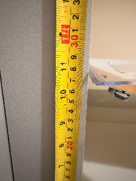
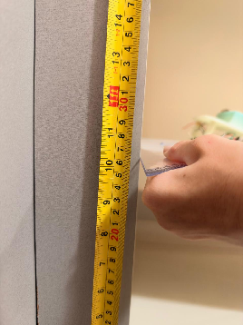
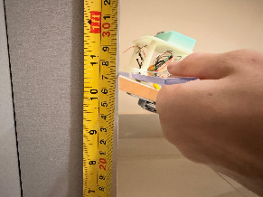
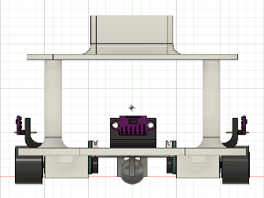
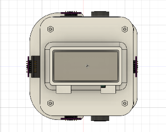

Testes de Estrutura
> Apresentar com detalhes os testes feitos para conferir se os objetivos da estrutura foram atendidos, incluindo:
>
> - Imagem com todas as peças separadas da estrutura (carcaça) do veículo;
> - Imagem que apresente a estrutura já montada (sem necessidade de partes internas, como eletrônica ou motores);
> - Ilustração contemplando o carro montado virtualmente em alguma ferramenta de CAD, no intuito de verificar se as peças foram construídas e montadas em conformidade com o projeto.
ID	Descrição	Data de Início	Data de Conclusão	Responsável	Resultados Esperados	Resultados Obtidos	Aprovação Interna (S/N)	Aprovação do Orientador (S/N)	Observações
1.1	Teste de Atrito das rodas No intuito de garantir que o Micromouse não irá deslizar ou derrapar durante a realização do labirinto, foi realizado o teste de atrito entre as rodas e o chão. A partir da estática é possível determinar o coeficiente de atrito(μ) estático por meio da tangente do ângulo, entre o mdf e a horizontal, na iminência do movimento.	23/10/2026	24/10/2026	1. João Felipe Veloso Rosa 2. Lorena Rege de Sousa Alves	→ Os nossos resultados esperados estão associados a bibliografia encontrada sobre o teste de atrito de um micromouse em: https://micromouseonline.com/2008/03/24/tyres-and-traction/. → Nesse relato do Micromouse Online, o autor testa pneus Mini-Z destinados ao seu micromouse. Ele utiliza um suporte de 100 g, com as rodas impedidas de girar, e mede com uma balança de mola a força necessária para iniciar o deslizamento sobre uma seção limpa do labirinto. Os melhores pneus deslizam com uma leitura de aproximadamente 43 gramas-força, e os piores, com 16 gramas-força. Dessa forma: μ = 0,16 a 0,43	μ₁ = 0,360; μ₂ = 0,351; μ₃ = 0,357 ⇒ μ médio = 0,356	S		MDF: 80 cm. Massa do chassi: 254 g. Experimento em triplicata. Medições: 27,1 cm; 26,5 cm; 26,9 cm. Requisito contemplado: RF8. Imagens na seção de apoio 1.1.
1.2	Teste e Análise de Massa e Centro de Gravidade Avaliação das propriedades físicas, da posição do centro de gravidade, dos momentos de inércia e da estabilidade estática do conjunto mecânico do Micromouse, com estimativa teórica preliminar dos limites de tombamento.	23/10/2026	24/10/2026 (análise preliminar)	Gabrielly Carvalho de Freitas	Caracterizar as propriedades físicas do conjunto mecânico, estimar os limites teóricos de estabilidade ao tombamento e estabelecer os critérios necessários para avaliar uma margem de segurança mínima de 10% em etapa posterior.	Massa: 458,99 g; CG = (-0,223; 38,779; -4,725) mm; altura estimada do CG: 43,249 mm. Limites preliminares de tombamento: lateral ≈ 43,1° e 9,19 m/s²; para trás ≈ 19,6° e 3,49 m/s²; para a frente ≈ 38,6° e 7,83 m/s². A direção para trás apresenta o menor limite teórico.	S	Pendente.	Análise teórica preliminar; validação da margem de segurança de 10% pendente da definição da velocidade máxima e do raio mínimo de curva. Cálculos, hipóteses, limitações e imagens na seção de apoio 1.2.
1.3	Teste de rotação do chassi no labirinto Faz-se fundamental que o carrinho possa realizar o labirinto sem se chocar com as paredes. Pensando nisso, realizamos o teste de rotação do chassi no labirinto no Fusion e com o labirinto e chassi físicos.	23/10/2026	25/10/2026	1. João Felipe Veloso Rosa 2. Jean David Bento dos Santos	→ Esperamos que o carrinho seja capaz de girar em cada célula e fazer curvas sem se chocar com a parede.	→ FUSION: O carrinho cumpriu o esperado. Contudo, mostrou-se interessante analisar se, mesmo assim, não deveríamos diminuir o tamanho do chassi. Além dessa conclusão, o teste no Fusion mostrou importante que estudemos como poderíamos centralizar na célula inicial, de forma precisa, o micromouse e como o micromouse se descentraliza ao fazer uma rotação no próprio eixo. → FÍSICO: O carrinho está aprovado, mas exige que o robô esteja bem centralizado na célula,  antes de iniciar as rotações para evitar que a frente raspe nas paredes durante as curvas. Executando tranquilamente curvas a 90º, porém enfrentando dificuldades para curvas além disso.	S		O teste no Fusion está no link abaixo: https://youtu.be/wofala7RS_4?si=MMv4koZQcceX7j3y
1.4	Teste de fixação e suportes Avaliação estática da montagem mecânica, tolerâncias de encaixe, restrição de graus de liberdade dos motores e verificação estrutural dos suportes em impressão 3D.	23/10/2026	24/10/2026	Gabrielly Carvalho de Freitas	Travamento total dos graus de liberdade dos motores, encaixe seguro do sensor de distância e validação dimensional do hardware de fixação (parafusos e porcas) para suportar as futuras vibrações do chassi.	A montagem estática cumpriu o objetivo de restringir movimentos indesejados. O suporte do motor travou corretamente os eixos laterais, verticais e rotacionais, e o suporte do sensor de distância demonstrou excelente retenção. A seleção de materiais provou-se dimensionalmente adequada (chassi em ABS para suportar impactos e suportes em PETG visando suportar a carga térmica dos motores). No entanto, durante o processo de montagem, identificou-se que os parafusos M3 de 8 mm especificados inicialmente eram curtos demais para proporcionar um aperto seguro atravessando toda a espessura das peças. Para corrigir isso e garantir a margem de segurança contra vibrações, as peças de fixação serão substituídas por parafusos M3 de 12 mm, o que resolve o problema e assegura o rosqueamento completo nas porcas.	S	Pendente.	
Registros e análises de apoio
1.1 — Teste de atrito das rodas
1ª medição: 27,1 cm

2ª medição: 26,5 cm

3ª medição: 26,9 cm

1.2 — Teste e análise de massa e centro de gravidade
1. Propriedades físicas e geometria
As propriedades físicas do conjunto mecânico foram obtidas por meio da ferramenta Physical Properties do Autodesk Fusion 360, considerando o modelo CAD da montagem do Micromouse.
1.1. Propriedades gerais
Propriedade	Valor
Massa total	458,99 g (0,45899 kg)
Volume	216.300 mm³
Densidade média (exibida pelo software)	0,002 g/mm³
Comprimento da caixa delimitadora	133,817 mm
Largura da caixa delimitadora	95,725 mm
Altura da caixa delimitadora	135,2 mm
A densidade média foi verificada pela relação direta entre massa (m) e volume (V):
ρ = m / V
ρ = 458,99 / 216.300 ≈ 0,00212 g/mm³
Nota: Este valor é compatível com o arredondamento apresentado pelo software e corresponde à média do conjunto modelado, não à densidade individual.
O peso estimado (P) do robô sob a aceleração gravitacional (g = 9,81 m/s²) é:
P = m · g
P = 0,45899 · 9,81 ≈ 4,50 N
Ressalta-se que as dimensões da caixa delimitadora descrevem a extensão máxima do modelo CAD nos três eixos. Estas não devem ser utilizadas diretamente como dimensões da base de apoio, pois os limites externos do chassi não coincidem necessariamente com os pontos de contato das rodas com o solo.
1.2. Centro de massa
As coordenadas do Centro de Gravidade (CG) fornecidas pelo Fusion 360, em relação à origem utilizada na montagem, são:
CG = (-0,223; 38,779; -4,725) mm
Considerando que o eixo Y é vertical, a coordenada vertical do centro de massa é Y(CG) = 38,779 mm. Como a origem do modelo não coincide com o plano do chão (cuja coordenada vertical estimada do plano de contato é Y(chão) = -4,47 mm), a altura estimada do centro de massa (h) em relação ao solo é:
h = Y(CG) - Y(chão)
h = 38,779 - (-4,47) = 43,249 mm
Esta variável é fundamental, pois quanto menor for a altura do CG, maior será a aceleração horizontal necessária para iniciar o tombamento.
1.3. Momentos de inércia
Os momentos e produtos de inércia extraídos estão descritos abaixo.
Em relação ao centro de massa (g·mm²):
Ixx: 863.100
Iyy: 929.100
Izz: 1.051.000
Ixy: 3.376,969 | Ixz: -313,719 | Iyz: -31.379,201
Em relação à origem do modelo (g·mm²):
Ixx: 1.564.000
Iyy: 939.300
Izz: 1.741.000
Ixy: 7.345,365 | Ixz: -797,222 | Iyz: 52.718,232
Os momentos de inércia são propriedades que caracterizam a distribuição da massa e a resistência à aceleração angular. Contudo, como ainda não há uma análise dinâmica rotacional desenvolvida a partir deles para validar o comportamento em curvas, estes valores servem, por ora, apenas como registro e base teórica para cálculos futuros. O limite estático de tombamento baseia-se prioritariamente na altura do centro de massa e na geometria de apoio.

Figuras 1,2 e 3 referentes ao CG em vista frontal, lateral e superior, respectivamente
2. Fundamentação teórica da estabilidade ao tombamento

2.1. Polígono de suporte
A estabilidade estática de um robô sobre rodas depende da posição da projeção vertical do seu centro de massa em relação ao "polígono de suporte", delimitado pelos pontos de contato das rodas com o solo. Como o Micromouse possui três pontos de apoio, o polígono é triangular. Enquanto a projeção do CG permanecer no interior desse triângulo, o conjunto mantém o equilíbrio estático.
2.2. Equilíbrio de momentos
Durante uma aceleração horizontal, a força inercial atua no centro de massa (localizado acima do plano de contato), gerando um momento de tombamento (M(tomb) = m · a · h). Para equilibrar, o peso do robô gera um momento estabilizador (M(est) = m · g · d), onde "d" é a distância horizontal entre a projeção do CG e a aresta do triângulo de apoio.
Igualando os momentos no instante teórico de tombamento (m · a · h = m · g · d), isola-se a aceleração crítica:
a(crit) = g · (d / h)
2.3. Ângulo crítico de tombamento
Numa análise estática, o tombamento ocorre quando a inclinação faz a linha de ação do peso ultrapassar o polígono de suporte. O ângulo crítico é:
θ(crit) = arctan (d / h)
3. Geometria preliminar dos pontos de apoio
Para a análise preliminar, foram extraídas as coordenadas dos centros das rodas (eixo X, Y, Z):
Roda 1: (58,723; 6,448; -20,088)
Roda 2: (-58,723; 6,448; -20,088)
Roda boba: (0; 3,000; 30,000)
Distâncias no plano horizontal (X, Z):
Distância entre as rodas principais (L12): 58,723 - (-58,723) = 117,446 mm
Distância da roda principal até a roda boba (L1C e L2C): √((58,723 − 0)² + (−20,088 − 30)²) ≈ 77,18 mm
Observação: As coordenadas informadas representam os centros das rodas.
4. Estimativa preliminar dos limites direcionais
Utilizando a altura h = 43,249 mm e estimando as distâncias disponíveis (d) a partir das coordenadas centrais, temos as seguintes estimativas de limite direcional:
Direção lateral: d(lat) ≈ 40,5 mm
Longitudinal (para trás): d(trás) ≈ 15,363 mm
Longitudinal (para a frente): d(frente) ≈ 34,5 mm
4.1. Tombamento lateral (estimativa)
θ(lat) = arctan (40,5 / 43,249) ≈ 43,1°
a(lat) = 9,81 · (40,5 / 43,249) ≈ 9,19 m/s² (aprox. 0,94 g)
4.2. Tombamento longitudinal para trás (estimativa)
θ(trás) = arctan (15,363 / 43,249) ≈ 19,6°
a(trás) = 9,81 · (15,363 / 43,249) ≈ 3,49 m/s²
4.3. Tombamento longitudinal para a frente (estimativa)
θ(frente) = arctan (34,5 / 43,249) ≈ 38,6°
a(frente) = 9,81 · (34,5 / 43,249) ≈ 7,83 m/s²
Os resultados apontam preliminarmente que a direção longitudinal para trás apresenta o menor limite teórico, sugerindo maior sensibilidade ao empinamento durante acelerações bruscas.
5. Estabilidade dinâmica e comportamento em curvas
Para realizar curvas, o robô requer aceleração lateral. Numa trajetória de raio "R" a uma velocidade "v", a aceleração exigida é:
a(op) = v² / R
O Fator de Segurança (FS) relaciona a aceleração crítica teórica com a aceleração operacional demandada:
FS = a(crit) / a(op)
Para o projeto mecânico, estabelece-se o critério de margem de segurança de 10% (FS ≥ 1,10). Como a velocidade máxima e o raio mínimo de curva ainda não foram definidos para o chassi físico, esse critério será avaliado posteriormente.
6. Resultados obtidos e limitações
A análise preliminar caracterizou a massa do robô (458,99 g), a posição tridimensional do centro de massa e os momentos de inércia do conjunto. Com a construção geométrica provisória do triângulo de suporte, estimou-se as acelerações críticas e inclinações teóricas para o conjunto, indicando que a direção longitudinal para trás apresenta as tolerâncias geométricas mais restritas.
7. Conclusão
O estudo mecânico preliminar do Micromouse sugere um comportamento teórico favorável no plano lateral, com possíveis restrições de empinamento durante arrancadas severas.
