# Testes de Hardware

<!-- Apresentar com detalhes os testes feitos para conferir se os objetivos do *hardware* foram atendidos, incluindo:

1. Processamento (Arduino, ESP32 etc):
   - Definir interface de desenvolvimento;
   - Rodar exemplo mínimo.
2. Sensores (temperatura, pressão, posição, velocidade etc.):
   - Realizar leitura básica de dados;
   - Validar/calibrar leituras;
   - Definir taxas de amostragem e quantidade de dados para transmissão e/ou armazenamento;
   - Validar taxas definidas e quantidade de dados;
   - Realizar processamento básico de dados (*thresholding*, filtro média-móvel etc.).
3. Armazenamento (memória interna, cartão SD, pendrive etc.):
   - Armazenar dados básicos;
   - Armazenar e validar dados de sensores.
4. Atuadores (Motores DC, relés, LEDs etc.):
   - Realizar acionamentos básicos;
   - Realizar acionamentos com base em dados de sensores;
   - Realizar processamento básico de dados (PWM etc.).
5. Comunicações (UART, I2C, SPI, USB, WiFi, Bluetooth etc.):
   - Transmissão básica de dados;
   - Transmissão de dados de sensores dentro da taxa de amostragem. -->

| **ID** | **Descrição** | **Data de Início** | **Data de Conclusão** | **Responsável** | **Resultados Esperados** | **Resultados Obtidos** | **Aprovação Interna (S/N)** | **Aprovação do Orientador (S/N)** | **Observações** |
|:------:|---------------|--------------------|-----------------------|-----------------|--------------------------|------------------------|:---------------------------:|:--------------------------------:|-----------------|
| 3.1 | **Processamento — interface de desenvolvimento.** Configurar o ambiente da placa ESP32 de 38 pinos (módulo ESP32-WROOM-32) com VS Code, PlatformIO e _framework_ Arduino e compilar o _firmware_. | 22/10/2026 | 22/10/2026 | Artur Handow Krauspenhar; Laura de Carvalho Feitosa | `pio run` compila o ambiente `esp32dev` sem erros, com as bibliotecas `pololu/VL53L0X@1.3.1` e `links2004/WebSockets@2.6.1` baixadas na versão fixada no `platformio.ini`. | Compilação concluída com sucesso em 24,3 s, sem erros. PlatformIO Core 6.2.0; plataforma Espressif 32, framework-arduinoespressif32 3.3.12. Dependências resolvidas: VL53L0X 1.3.1, WebSockets 2.6.1, SD, SPI, WiFi e Wire 3.3.12. Uso de memória: RAM 15,4% (50 616 de 327 680 bytes) e Flash 92,2% (1 208 788 de 1 310 720 bytes). | S | | Apenas o computador. A Flash em 92,2% deixa pouca folga para o código. Se faltar espaço, trocar a tabela de partições para uma com área de aplicação maior. |
| 3.2 | **Processamento — exemplo mínimo.** Gravar o _firmware_ pela USB e acompanhar a inicialização no monitor serial. | 22/10/2026 | 22/10/2026 | Artur Handow Krauspenhar; Laura de Carvalho Feitosa | Gravação concluída com `pio run -t upload`; o monitor serial mostra "Micromouse iniciado" sem mensagens de erro dos _drivers_ dos módulos ligados (sem o cartão, apenas o aviso "cartão SD não encontrado"); o LED de status acende. | Gravação de 1 224 336 bytes (799 645 comprimidos) em 20,9 s, com verificação do _hash_ concluída e sucesso em 37,9 s. Após o _reset_, o monitor mostrou "Micromouse iniciado" cerca de 1,9 s depois de ligar e o LED de status acendeu; ao segurar o botão RST/EN o LED apaga e volta ao fim da inicialização. Sem os módulos ligados, o _firmware_ avisou a ausência de cada um e seguiu a inicialização sem travar. As três tarefas do FreeRTOS iniciaram (janela de ~3,1 s), sensores 156 ciclos, controle 310 e comunicação 31, compatíveis com 20, 10 e 100 ms definidos para cada tarefa. | S | | Somente o ESP32 alimentado pela USB, sem módulos. Os erros `i2cWrite() ... ESP_ERR_INVALID_STATE` são esperados sem módulos, e os avisos `gpio_pullup_en ... input-only pad` vêm do PCNT tentando ativar _pull-up_ interno nos pinos dos encoders, que não o têm, sem efeito na contagem. |
| 3.3 | **Sensores — leitura básica dos sensores de distância.** Iniciar os três VL53L0X (frente, esquerda e direita) com a troca de endereço pelas linhas XSHUT e ler as distâncias. | 22/10/2026 | 22/10/2026 | Laura de Carvalho Feitosa; Vitor Coelho Costa | O _scan_ do I2C mostra os três sensores em 0x30 a 0x32; as três distâncias (mm) aparecem no monitor e variam ao aproximar e afastar um obstáculo; após _reset_ pelo botão de reset (EN) da placa, sem desligar a alimentação, os três sensores reiniciam sem erro. | Inicialização dos três sensores concluída em 171 ms, com o _scan_ mostrando 0x30 (direita), 0x31 (frente) e 0x32 (esquerda). Sem obstáculo à frente, o sensor frontal não tinha alvo ao alcance e alternou entre leitura inválida (65535); esquerda e direita, com objetos próximos, leram 53 a 63 mm e 105 a 122 mm. Com obstáculos próximos aos três sensores, as leituras ficaram estáveis. Antes da montagem conjunta, cada módulo foi testado isoladamente com o `exemplo_distancia_unico`: os três responderam em 0x29 e mediram distâncias corretamente. | S | | Realizado em protoboard, com o ESP32 alimentado pela USB. Na primeira montagem nenhum sensor respondeu no I2C. A verificação do nível das linhas antes de iniciar o barramento e o teste de um módulo isolado mostraram as linhas SDA e SCL invertidas. |
| 3.4 | **Sensores — calibração dos sensores de distância.** Posicionar uma parede branca a distâncias conhecidas (50, 100, 180 e 300 mm) e registrar média e desvio padrão de 50 leituras por sensor; obter ganho e offset de uma correção linear para cada sensor. | 22/10/2026 | 22/10/2026 | Laura de Carvalho Feitosa; Vitor Coelho Costa | Após a correção, erro médio de até 10 mm entre 50 e 180 mm; parede detectada a pelo menos 30 cm; ganho e offset de cada sensor registrados para uso no _driver_. | Erro sem correção: frente +33 a +48 mm, esquerda +15 a +55 mm, direita −14 a +9 mm; desvio padrão das leituras entre 2,2 e 6,3 mm. Correção linear ajustada pelos quatro pontos de cada sensor (mínimos quadrados): frente ganho 0,943 e offset −28,6 mm; esquerda ganho 0,889 e offset −17,0 mm; direita ganho 0,995 e offset +3,9 mm. Erro médio corrigido entre 50 e 180 mm: frente 2,1 mm, esquerda 10,0 mm e direita 9,3 mm; maior erro em um ponto: 2,9 mm, 14,4 mm e 12,1 mm. Os três sensores detectaram a parede a 300 mm com leitura estável (desvio de 3,4 a 6,3 mm). Com a parede diante de cada sensor, só a leitura daquele sensor mudou, confirmando frente (0x31), esquerda (0x32) e direita (0x30). | S | | Realizado em protoboard. Tecla "m" no `exemplo_distancia` (média e desvio de 50 leituras). O ganho e o _offset_ ainda não são aplicados pelo _driver_. O limiar de parede depende da posição dos sensores no chassi e será definido com o CAD e confirmado no robô montado. Comparação com o datasheet: com o orçamento de medida de 20 ms usado no _firmware_ (perfil _High speed_), a precisão indicada é de ±5%. O desvio padrão medido fica dentro disso, exceto no sensor da direita a 50 mm (4,4 mm, 8,8%). O erro sem correção é maior que o do datasheet porque a especificação supõe o _offset_ calibrado a 10 cm, e a biblioteca da Pololu não faz essa calibração; a correção linear cumpre esse papel. Depois da correção, o datasheet admite variação de até 3% com a distância: o sensor da frente atende (2,9 mm), mas esquerda e direita ficam acima em 100 mm (14,4 mm e 10,6 mm) e a direita também em 50 mm (12,1 mm). Como o ponto de 100 mm foi refeito duas vezes e fica fora da reta dos demais, a causa provável é a posição da parede na medida. |
| 3.5 | **Sensores — leitura básica da IMU.** Ler a velocidade angular do eixo Z do MPU6050 e integrar o ângulo de guinada. | 22/10/2026 | 22/10/2026 | Artur Handow Krauspenhar; Vitor Coelho Costa | O _scan_ do I2C mostra o MPU6050 em 0x68; o ângulo aparece no monitor a cada 200 ms e muda ao girar o conjunto. | O _scan_ do I2C mostrou o MPU6050 em 0x68 e o _driver_ iniciou e calibrou o _offset_ do eixo Z. Parado, a velocidade angular ficou entre −0,25 e +0,30 °/s e o ângulo variou 0,03° em 2,2 s. Ao girar o conjunto cerca de 45° à mão no sentido anti-horário, o ângulo subiu durante o giro e parou em 45,2°, ficando entre 44,9° e 45,3° nos 3,4 s seguintes. | S | | Realizado em protoboard. |
| 3.6 | **Sensores — validação da IMU.** Calibrar o _offset_ do giroscópio com o conjunto parado, girá-lo 90° à mão para cada lado sobre uma marca na mesa e medir a deriva parado. | 22/10/2026 | 22/10/2026 | Artur Handow Krauspenhar; Vitor Coelho Costa | Giro à esquerda indica cerca de +90° e à direita cerca de −90°, com erro de até ±3°; deriva do ângulo com o conjunto parado registrada após 1 minuto. | Giro de 90° para a direita (horário): o ângulo terminou em −87,8° e ficou entre −87,8° e −87,6° nos 4,6 s seguintes, erro de 2,2° a 2,4°. O sinal confirma o sentido esperado: positivo à esquerda e negativo à direita. Com o conjunto parado após o giro, o ângulo variou 0,17° em 4,6 s | S | | Realizado em protoboard. Exemplo `exemplo_imu`: "c" recalibra, "z" zera o ângulo. A deriva de cerca de 2,2°/min acumula erro nas curvas de uma corrida longa, e o controle do robô deve recalibrar o _offset_ com o robô parado e usar as paredes para corrigir o alinhamento. |
| 3.7 | **Sensores — leitura básica do monitor de energia.** Ler a tensão e a corrente da bateria pelo INA219. | 22/10/2026 | 22/10/2026 | Laura de Carvalho Feitosa; Vitor Coelho Costa | O _scan_ do I2C mostra o INA219 em 0x40; a tensão e a corrente aparecem no monitor a cada 500 ms, com a tensão dentro da faixa da bateria LiPo 2S (6,6 V a 8,4 V). | O _scan_ do I2C mostrou o INA219 em 0x40, e o _driver_ o iniciou. Com a bateria LiPo 2S ligada ao Vin+, a tensão ficou estável em 7,652 V, dentro da faixa de 6,6 a 8,4 V. Sem carga no Vin−, a corrente ficou entre −0,1 e +0,2 mA. Com o Vin+ no conector de balanceamento (uma célula), a leitura foi de 3,824 V em uma das medidas e de 3,499 V em outra. | S | | Realizado em protoboard. Ligação: + da bateria no Vin+, Vin− sem carga e − da bateria no GND comum com o ESP32. Comparação com o datasheet: com PGA /8 e _shunt_ de 0,1 Ω, o _offset_ de entrada típico de ±40 µV equivale a ±0,4 mA, então a corrente de −0,1 a +0,2 mA sem carga é coerente com o datasheet. |
| 3.8 | **Sensores — validação do monitor de energia.** Comparar tensão e corrente do INA219 com um multímetro, em repouso e com os motores girando. | 22/10/2026 | | Laura de Carvalho Feitosa; Vitor Coelho Costa | Erro de até 2% na tensão e na corrente em relação ao multímetro; corrente positiva com a bateria descarregando. | Em repouso, o INA219 indicou 7,652 V e o multímetro cerca de 7,6 V nos terminais da bateria, diferença de cerca de 0,05 V. Sem carga, a corrente do INA219 ficou entre −0,1 e +0,2 mA. A comparação com os motores girando não foi feita. | N | | Realizado em protoboard. A parte com carga fica para o robô montado, com a ponte H e os motores ligados depois do INA219. Aprovação interna N porque o teste prevê também a medida com carga; a diferença de cerca de 0,05 V em repouso está dentro do critério de 2%. O datasheet indica erro máximo de ±0,5% na tensão a 25 °C (cerca de ±38 mV a 7,65 V), mas a resolução do multímetro (0,1 V, cerca de 1,3%) não permite confirmar essa precisão; para isso é preciso um multímetro com resolução de 0,01 V. |
| 3.9 | **Sensores — leitura básica dos encoders.** Ler a contagem dos encoders dos dois motores N20, com a ponte H desligada. | 22/10/2026 | 22/10/2026 | Artur Handow Krauspenhar; Vitor Coelho Costa | A contagem de cada encoder aparece no monitor e muda ao girar a roda correspondente à mão; a roda parada não altera a contagem. | Os dois encoders foram configurados no PCNT e começaram com contagem 0. Ao girar a roda direita à mão, só a contagem da direita mudou (até −75); ao girar a esquerda, só a da esquerda (até 43). Com as rodas paradas, as contagens ficaram constantes. | S | | Realizado em protoboard. M1 e M2 dos motores soltos. Os avisos `gpio_pullup_en ... input-only pad` no início vêm do PCNT tentando ativar _pull-up_ interno nesses pinos, que não o têm, sem efeito na contagem. |
| 3.10 | **Sensores — validação dos encoders.** Girar cada roda uma volta completa à mão, com a ponte H desligada, e conferir a contagem e o sentido. | |  | Artur Handow Krauspenhar; Vitor Coelho Costa | Uma volta da roda gera pulsos do encoder × redução × 4 contagens; girar no sentido definido como frente aumenta a contagem e o sentido inverso diminui; contagens equivalentes a uma célula de 18 cm calculadas e registradas. | Não realizado nesta etapa. | N | | Teste adiado: as contagens por volta e por célula serão medidas com o robô montado, deslocando-o 18 cm no chão, o que já inclui o diâmetro real da roda. O teste 3.9 mostrou que os dois encoders contam corretamente e de forma independente. |
| 3.11 | **Sensores — definição das taxas de amostragem e da quantidade de dados.** Definir com que frequência cada sensor é lido e calcular quantos dados são enviados e gravados. | 22/10/2026 | 22/10/2026 | Artur Handow Krauspenhar; Laura de Carvalho Feitosa | Taxa definida para cada sensor e tarefa; tamanho do pacote de telemetria e da linha gravada no SD calculados em bytes, com a taxa resultante em bytes/s. | Sensores de distância, IMU e monitor de energia lidos a cada 20 ms (50 Hz); encoders contados direto pelo _hardware_, sem perder pulsos; controle a cada 10 ms (100 Hz); telemetria e gravação no SD a cada 100 ms (10 Hz). O pacote de telemetria tem de 209 a 228 bytes, cerca de 2,3 kB/s na rede. A linha do SD tem de 37 a 50 bytes, cerca de 300 kB em uma corrida de 10 minutos, pouco perto dos 16 GB do cartão. | S | | Sem _hardware_: cálculo feito a partir do código. Os sensores de distância entregam uma medida nova a cada 20 ms, então ler mais rápido não traria dado novo. O tamanho de um pacote real ainda não foi medido. |
| 3.12 | **Sensores — validação das taxas e da quantidade de dados.** Medir quanto tempo leva a leitura dos sensores e se cada tarefa do FreeRTOS roda no período definido. | 22/10/2026 | 22/10/2026 | Laura de Carvalho Feitosa | A leitura dos sensores cabe no período de 20 ms; as tarefas de sensores, controle e comunicação rodam a cada 20, 10 e 100 ms sem acumular atraso; a quantidade de dados confere com o cálculo do teste 3.11. | A leitura dos três sensores de distância levou cerca de 2,3 ms, bem abaixo dos 20 ms disponíveis. No _firmware_ completo, as três tarefas rodaram no ritmo esperado, sem perder ciclos: em cerca de 3,1 s, a de sensores fez 156 ciclos (esperado ~155), a de controle 310 (~310) e a de comunicação 31 (~31). | S |  | Medidas aproveitadas dos testes 3.2, 3.3 e 3.4. Ainda falta registrar o tempo das tarefas com os sensores ligados e medir o tamanho de um pacote real. |
| 3.13 | **Sensores — processamento básico dos dados.** Aplicar limiar nas distâncias para detectar parede, média móvel nas leituras do INA219, remoção do _offset_ do giroscópio e filtro contra pulsos falsos nos encoders. | |  | Artur Handow Krauspenhar; Laura de Carvalho Feitosa | Parede detectada quando a distância fica abaixo do limiar; leitura do INA219 filtrada mais estável que a bruta; giroscópio sem deriva visível parado, logo após a calibração; rodas paradas não geram contagem com o Wi-Fi ligado. | Não realizado nesta etapa. | N | | Adiado para o robô montado, quando todos os sensores estarão ligados juntos e o limiar de parede poderá ser definido pela posição real dos sensores. |
| 3.14 | **Armazenamento — dados básicos.** Gravar 1000 linhas no formato da telemetria no cartão microSD e ler de volta para conferir. | 22/10/2026 | 22/10/2026 | Artur Handow Krauspenhar; Vitor Coelho Costa | O monitor mostra "1000 linhas conferidas, nenhuma diferente" e os tempos de escrita; no PC, o arquivo tem as 1000 linhas; sem cartão, o exemplo avisa e continua rodando. | O cartão foi montado em 58 ms e as 1000 linhas, de 139 bytes cada, foram gravadas em 0,38 s. A linha mais lenta levou 12,7 ms. Na leitura de volta, todas as linhas conferiram. | S | | Realizado em protoboard, com cartão SanDisk de 16 GB em FAT32. A gravação mais lenta (12,7 ms) cabe com folga nos 100 ms da tarefa que grava no cartão no _firmware_. A abertura do arquivo no PC confirmou o resultado. |
| 3.15 | **Armazenamento — dados de sensores.** Gravar no cartão as leituras reais dos sensores durante o funcionamento e conferir no PC. | |  | Artur Handow Krauspenhar; Vitor Coelho Costa | Uma linha por ciclo (10 por segundo), sem linhas faltando, com valores que batem com o que aconteceu durante a gravação (por exemplo, a distância cai quando a mão se aproxima de um sensor); a gravação não atrasa o controle. | Não realizado nesta etapa. | N | | Adiado para o robô montado, com o cartão e todos os sensores ligados juntos. O _firmware_ já grava as leituras no cartão, e a gravação em si foi validada no teste 3.14. |
| 3.16 | **Atuadores — acionamentos básicos.** Com os motores soltos na bancada, acionar cada motor para a frente, frear, acionar para trás e frear. | 22/10/2026 | 22/10/2026 | Laura de Carvalho Feitosa; Vitor Coelho Costa | Cada roda gira no sentido comandado e inverte ao trocar o sentido; o freio para a roda na hora; com a ponte desligada, a roda gira livre à mão. | O ciclo completo se repetiu sem falhas. Em cada etapa girou só o motor indicado, a ré girou ao contrário da frente, o freio parou a roda na hora e, com a ponte desligada, as rodas giraram soltas. | S | | Realizado em protoboard, com os motores ligados direto na bateria. A ponte H usada é a L298N, que substituiu a TB6612FNG do projeto inicial; como ela não tem pino de _standby_, a ponte é desligada zerando o PWM. O sentido de frente de cada motor só será definido com os motores no chassi. |
| 3.17 | **Atuadores — acionamento com base em sensores e PWM.** Variar a velocidade dos motores pelo PWM e medir a rotação pelos encoders; limitar a potência pela tensão da bateria; parar os motores quando o sensor da frente detecta parede. |  |  | Laura de Carvalho Feitosa | A rotação aumenta com o PWM; a potência máxima se ajusta à tensão da bateria; o motor para quando um obstáculo chega perto do sensor da frente e, com o robô montado, para antes de tocar a parede. | Não realizado nesta etapa. | N |  | Adiado para o robô montado, com motores, encoders, INA219 e sensor da frente ligados juntos. O acionamento básico dos motores já foi validado no teste 3.16. Como a L298N perde cerca de 2 V internamente, o limite de potência dos motores pode ser revisto a partir da curva medida. |
| 3.18 | **Comunicações — transmissão básica e dentro da taxa de amostragem.** Conferir a comunicação I2C com os sensores, conectar ao Wi-Fi e enviar a telemetria ao sistema web. | 22/10/2026 | 22/10/2026 | Artur Handow Krauspenhar | Todos os dispositivos I2C respondem; o ESP32 conecta ao Wi-Fi e a telemetria enviada pelo _firmware_ chega à API do _backend_. | A comunicação I2C funcionou com todos os sensores nos testes 3.3, 3.5 e 3.7. O ESP32 conectou ao ponto de acesso do celular e abriu a conexão WebSocket com a API do _backend_, que recebeu os pacotes de telemetria enviados pelo _firmware_. | S |  | Teste feito até o _backend_: a exibição dos dados no _frontend_ não foi testada. Rede usada: ponto de acesso do celular em 2,4 GHz. |

# Imagens dos testes

<figure>

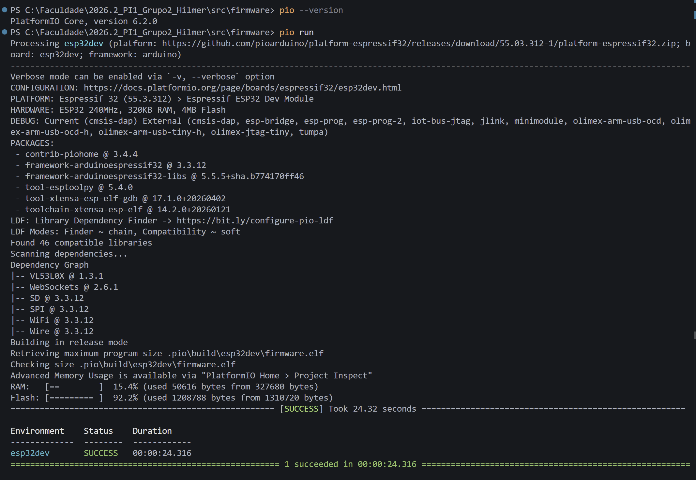

<figcaption>

**Figura 1.** Versão do PlatformIO e compilação do _firmware_ (`pio run`), com as dependências resolvidas e o uso de RAM e Flash (teste 3.1).

</figcaption>

</figure>

<figure>

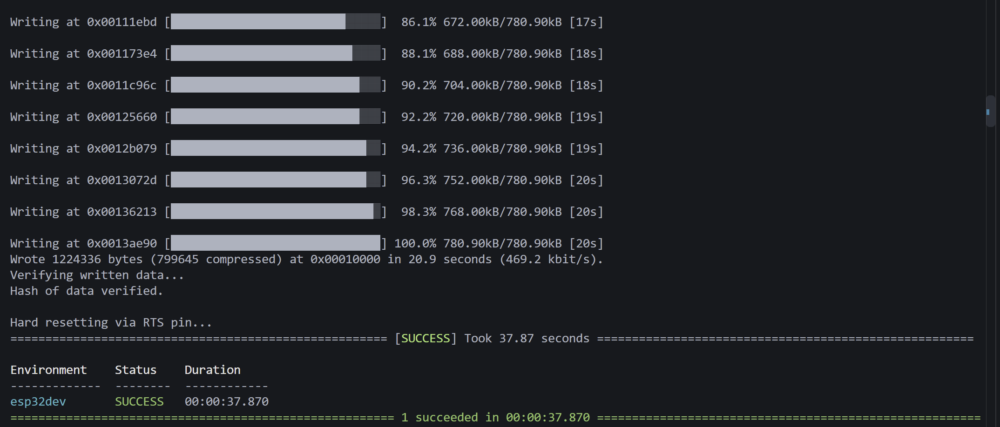

<figcaption>

**Figura 2.** Gravação do _firmware_ pela USB (`pio run -t upload`), com verificação do _hash_ (teste 3.2).

</figcaption>

</figure>

<figure>

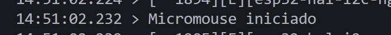

<figcaption>

**Figura 3.** Monitor serial com a mensagem de fim da inicialização (teste 3.2).

</figcaption>

</figure>

<figure>

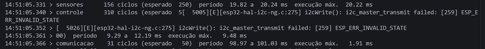

<figcaption>

**Figura 4.** Primeiro relatório de tempos das tarefas do FreeRTOS após a inicialização (teste 3.2).

</figcaption>

</figure>

<figure>

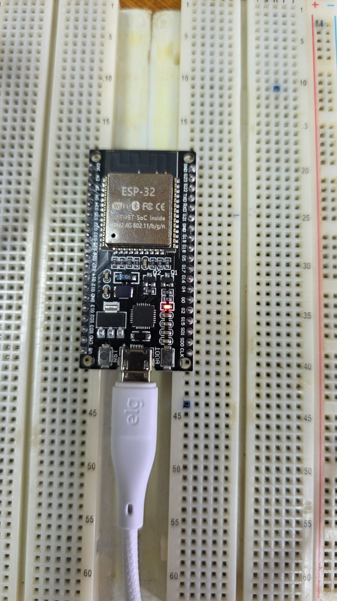

<figcaption>

**Figura 5.** ESP32 alimentado pela USB, com o LED de status (IO2) aceso após a inicialização (teste 3.2).

</figcaption>

</figure>

<figure>

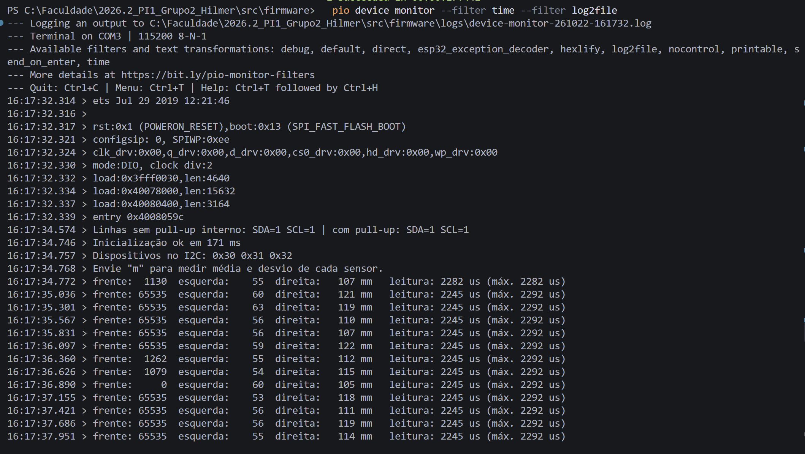

<figcaption>

**Figura 6.** Inicialização dos três VL53L0X, _scan_ do I2C (0x30 a 0x32) e leituras sem obstáculo à frente (teste 3.3).

</figcaption>

</figure>

<figure>

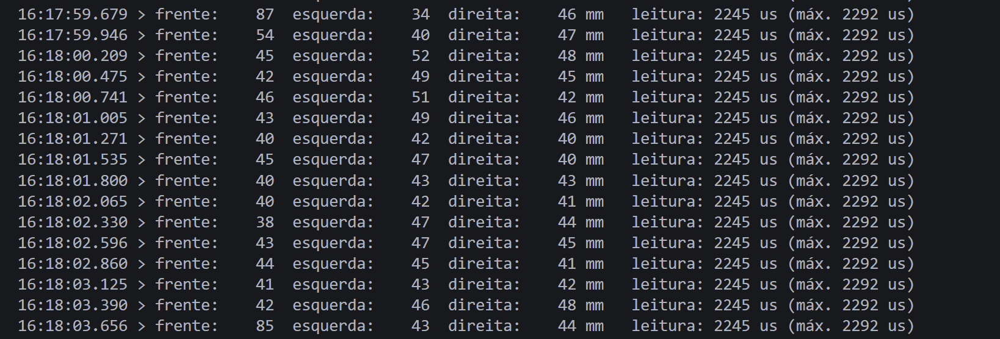

<figcaption>

**Figura 7.** Leituras estáveis dos três sensores de distância com obstáculos próximos (teste 3.3).

</figcaption>

</figure>

<figure>

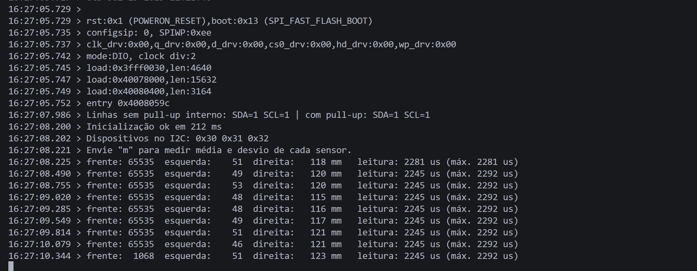

<figcaption>

**Figura 8.** Nova inicialização dos três sensores de distância após o _reset_ do ESP32 pelo botão RST/EN, sem desligar a alimentação (teste 3.3).

</figcaption>

</figure>

<figure>

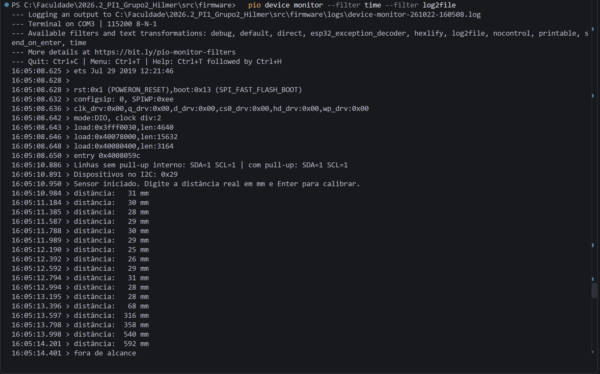

<figcaption>

**Figura 9.** Teste de um VL53L0X isolado com o `exemplo_distancia_unico`: linhas do I2C em nível alto, sensor no endereço de fábrica 0x29 e leituras ao afastar o obstáculo (teste 3.3).

</figcaption>

</figure>

<figure>

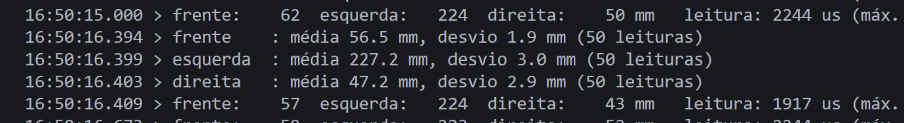

<figcaption>

**Figura 10.** Média e desvio padrão de 50 leituras de cada sensor, com a parede a 180 mm do sensor da esquerda (teste 3.4).

</figcaption>

</figure>

<figure>

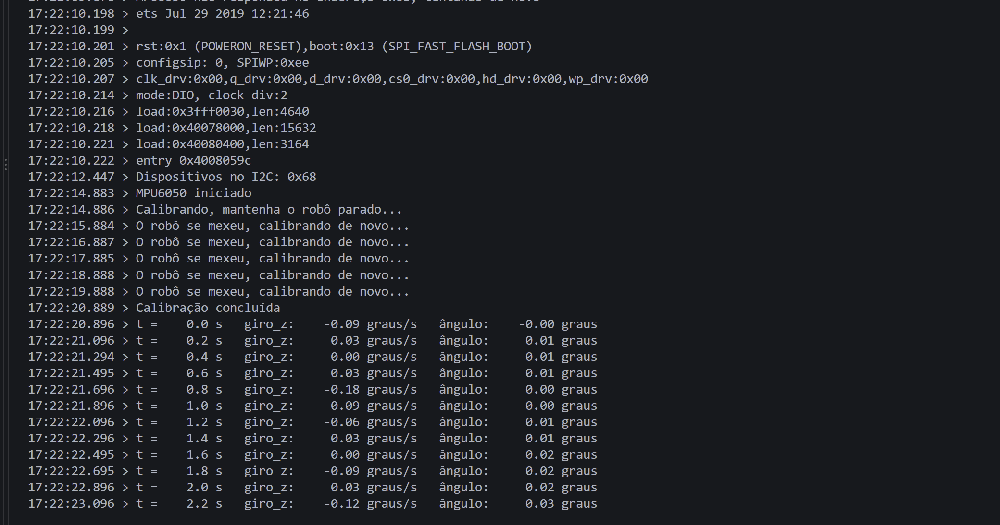

<figcaption>

**Figura 11.** _Scan_ do I2C, inicialização e calibração do MPU6050, com o conjunto parado (teste 3.5).

</figcaption>

</figure>

<figure>

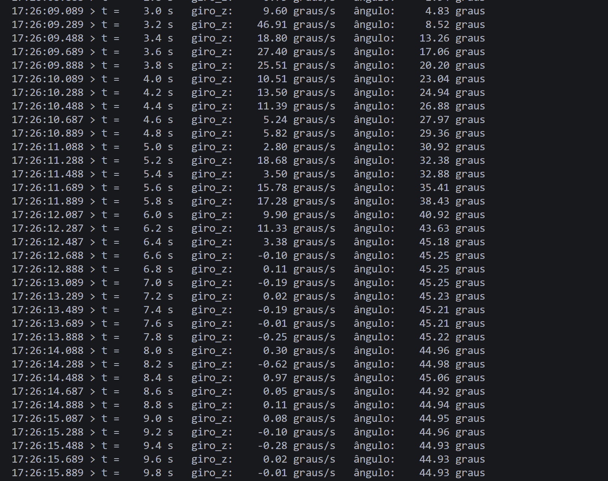

<figcaption>

**Figura 12.** Velocidade angular e ângulo integrado durante um giro de cerca de 45° no sentido anti-horário (teste 3.5).

</figcaption>

</figure>

<figure>

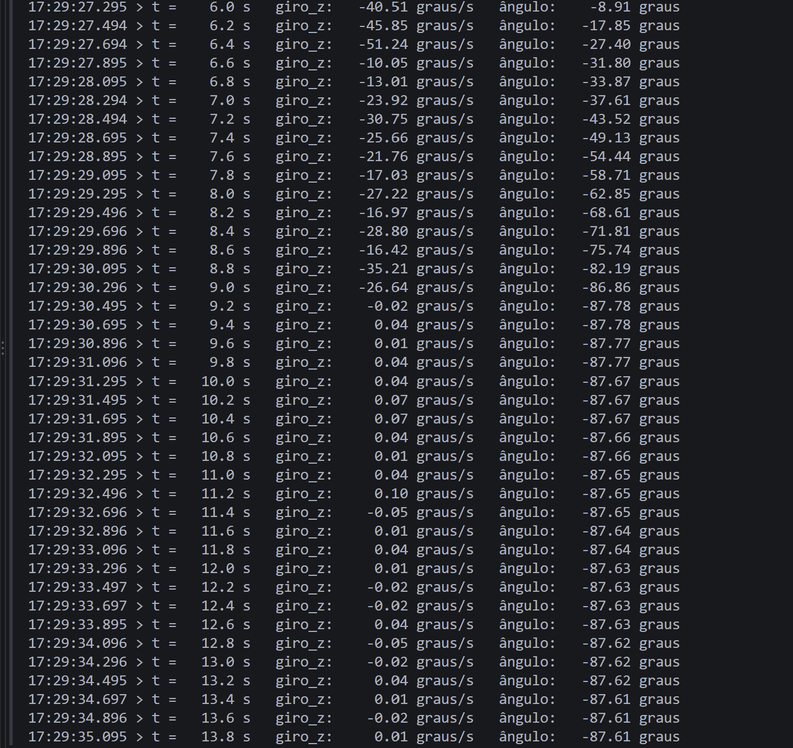

<figcaption>

**Figura 13.** Velocidade angular e ângulo integrado durante um giro de 90° para a direita, com o ângulo parado em cerca de −87,7° depois do giro (teste 3.6).

</figcaption>

</figure>

<figure>

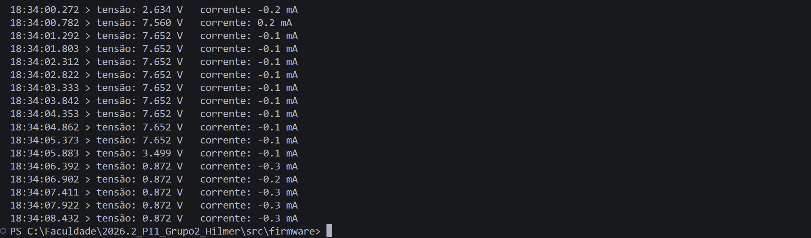

<figcaption>

**Figura 14.** Tensão e corrente lidas pelo INA219 ao ligar a bateria, ao passar para uma célula do conector de balanceamento e ao desconectar (teste 3.7).

</figcaption>

</figure>

<figure>

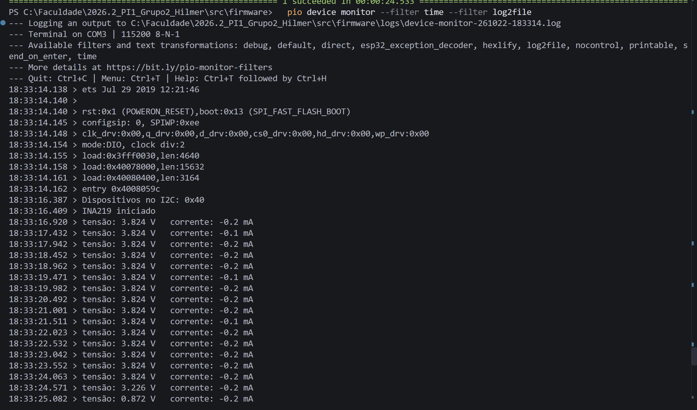

<figcaption>

**Figura 15.** _Scan_ do I2C com o INA219 em 0x40, inicialização e leitura de uma célula da bateria pelo conector de balanceamento (teste 3.7).

</figcaption>

</figure>

<figure>

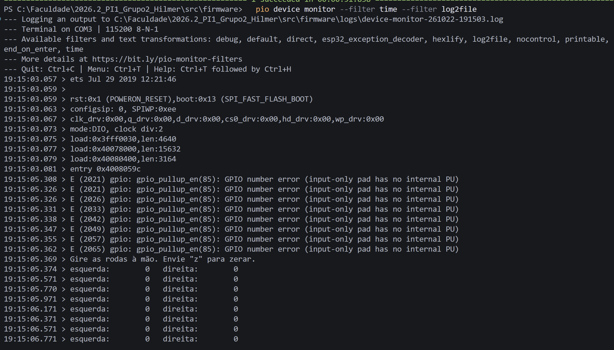

<figcaption>

**Figura 16.** Inicialização dos encoders pelo PCNT, com as contagens em zero (teste 3.9).

</figcaption>

</figure>

<figure>

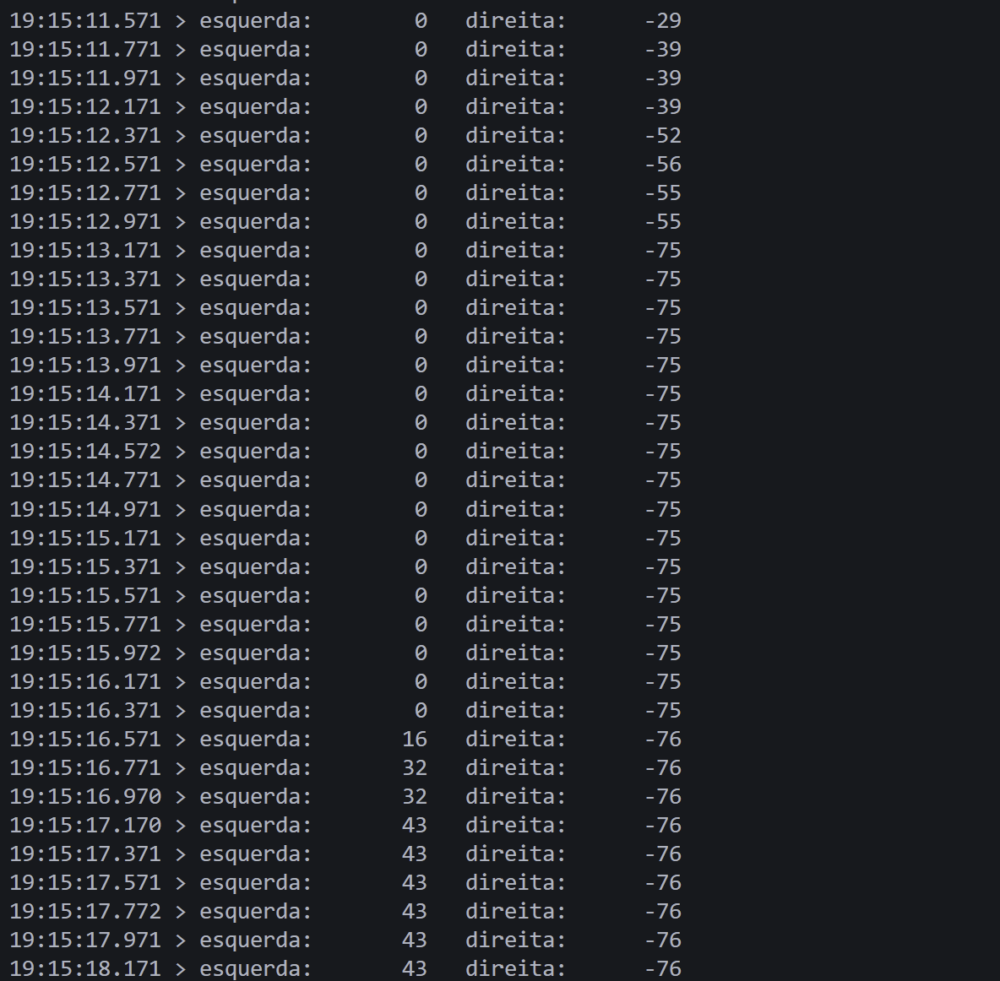

<figcaption>

**Figura 17.** Contagens dos encoders ao girar a roda direita e depois a esquerda à mão (teste 3.9).

</figcaption>

</figure>

<figure>

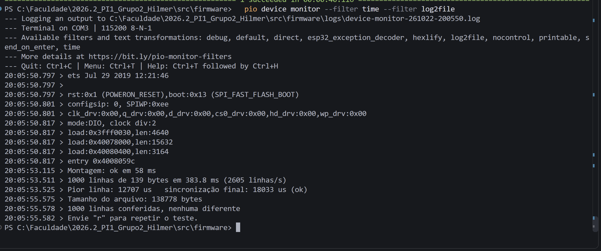

<figcaption>

**Figura 18.** Montagem do cartão, gravação de 1000 linhas, tempos de escrita e conferência da leitura de volta (teste 3.14).

</figcaption>

</figure>

<figure>

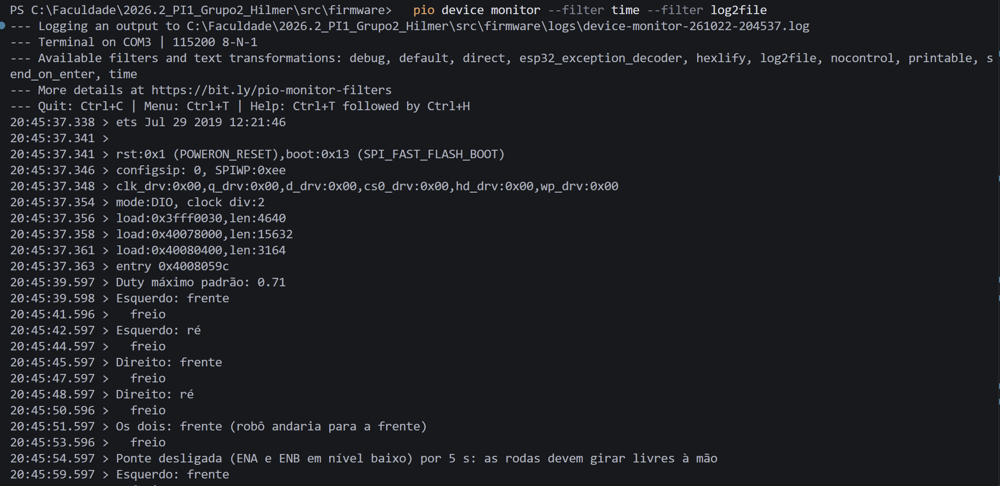

<figcaption>

**Figura 19.** Ciclo de acionamento dos motores pela ponte H L298N: cada motor para a frente, freio, ré e freio, os dois juntos e a ponte desligada (teste 3.16).

</figcaption>

</figure>
