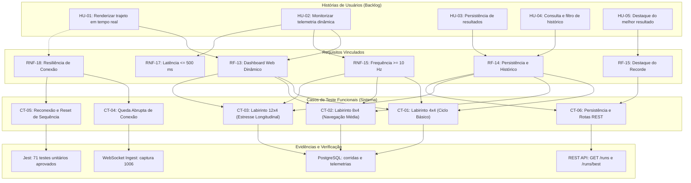

# Testes de Software

## 1. Introdução e Contexto

Este documento consolida o relatório formal dos **Testes de Software** do projeto Micromouse (Grupo 2 - PI1 / 2026.2), em conformidade com as diretrizes de avaliação da disciplina.

O subsistema de software é composto por:
1. **Frontend Web (Next.js / React 19 / Tailwind CSS):** Dashboard dinâmico para acompanhamento em tempo real da prova, exibição gráfica do labirinto (grid SVG), velocímetro, indicador de bateria, cronômetro e histórico de corridas com destaque de recordes.
2. **Backend (NestJS / Node.js):** Gateway WebSocket dedicado (`ws://<host>:3001/ingest`) para recepção e validação do fluxo de telemetria a 10 Hz (RNF-15), barramento interno de eventos desacoplado (`@nestjs/event-emitter`) e API HTTP REST (`http://<host>:3000/runs`) para consulta e auditoria de corridas.
3. **Camada de Persistência (PostgreSQL 16 & Prisma ORM):** Armazenamento relacional e estruturado das entidades `Labirinto`, `Corrida` e `Telemetria` (com suporte a payloads JSON de sensores).
4. **Módulo de Emulação de Hardware (Mock Emulator - `scripts/robot-emulator.ts`):** Emulador do Micromouse em TypeScript, capaz de simular trajetórias reais nos labirintos 4x4, 8x4 e 12x4, emitir eventos de ciclo de vida (`CALIBRATION_DONE`, `RUN_START`, `GOAL_REACHED`, `RUN_END`) e injetar telemetria periódica sob contratos estritos.

> **Alinhamento Metodológico com a Disciplina:**  
> Os testes aqui documentados cobrem os **Testes Funcionais do Sistema de Software com Emulador Mock** (Issue [#218](https://github.com/fcte-pi1/2026.2_PI1_Grupo2_Hilmer/issues/218)) e as **Suítes de Testes Automatizados Unitários e de Integração** (71 testes com 100% de aprovação). Os testes fim-a-fim (*End-to-End*) que envolvem a pista física e os dados reais emitidos pelo microcontrolador ESP32 na pista constituem os **Testes de Integração de Hardware/Software**, registrados separadamente em [`docs/7.5 - Testes de integração.md`](https://github.com/fcte-pi1/2026.2_PI1_Grupo2_Hilmer/blob/main/docs/7.5%20-%20Testes%20de%20integra%C3%A7%C3%A3o.md).

---

## 2. Histórias de Usuários e Protótipos Implementados

A tabela a seguir correlaciona as Histórias de Usuários (HUs) definidas no Ponto de Controle 1 com os protótipos de tela e as funcionalidades desenvolvidas e validadas:

| **ID da HU** | **História de Usuário** | **Requisito(s)** | **Prioridade** | **Protótipo / Interface Associada** | **Status** |
|:---:|---|:---:|:---:|---|:---:|
| **HU-01** | *Como operador da pista, desejo visualizar a posição e o trajeto percorrido pelo robô em tempo real em uma representação gráfica do labirinto, para verificar visualmente o progresso da exploração.* | RF-13 | Alta | [Protótipo do Dashboard](https://github.com/fcte-pi1/2026.2_PI1_Grupo2_Hilmer/blob/main/docs/figs/DashboardPrototipo.png) / Componente SVG interativo `MazeMap` | **Implementado e Validado** |
| **HU-02** | *Como operador da pista, desejo monitorar a velocidade atual, o nível de bateria e o cronômetro da corrida em tempo real com atualização frequente, para antecipar esgotamento de energia e paradas não programadas.* | RF-13, RNF-15, RNF-17 | Alta | [Protótipo do Dashboard](https://github.com/fcte-pi1/2026.2_PI1_Grupo2_Hilmer/blob/main/docs/figs/DashboardPrototipo.png) / Painel dinâmico de métricas (Cards, Gauge e Timer) | **Implementado e Validado** |
| **HU-03** | *Como equipe de desenvolvimento, desejo que todos os dados de telemetria e o desfecho de cada corrida sejam persistidos automaticamente em banco de dados, para que nenhuma medição seja perdida após o desligamento do robô.* | RF-14 | Alta | Banco PostgreSQL 16 (Tabelas `corridas`, `telemetrias`, `labirintos`) via Prisma ORM | **Implementado e Validado** |
| **HU-04** | *Como operador, desejo acessar um histórico consolidado das corridas anteriores com filtros por tamanho de labirinto (4x4, 8x4, 12x4), para comparar o desempenho do robô entre diferentes tentativas.* | RF-14 | Média | [Protótipo do Histórico](https://github.com/fcte-pi1/2026.2_PI1_Grupo2_Hilmer/blob/main/docs/figs/HistoricoPrototipo.png) / Rota `/historico` e API REST `GET /runs` | **Implementado e Validado** |
| **HU-05** | *Como competidor, desejo que o sistema destaque o menor tempo obtido em cada labirinto como o recorde atual, para identificar de forma imediata a melhor tentativa realizada.* | RF-15 | Baixa | Rota `/historico` (Card de Recorde) e API REST `GET /runs/best` | **Implementado e Validado** |

### 2.1. Diagrama Visual de Rastreabilidade (HUs $\times$ Requisitos $\times$ Casos de Teste)

O diagrama a seguir sintetiza a cadeia de rastreabilidade entre as Histórias de Usuário do Backlog, os requisitos atendidos, os casos de testes funcionais e as evidências de validação geradas no sistema:



---

## 3. Matriz de Rastreabilidade: Requisitos $\times$ Casos de Teste

| **Requisito** | **Descrição Resumida** | **Casos de Teste Vinculados** | **Resultado** |
|:---:|---|:---:|:---:|
| **RF-13** | Dashboard Web dinâmico (trajeto, bateria, velocidade, tempo de conclusão, desafio cumprido). | CT-01, CT-02, CT-03 | **Aprovado** |
| **RF-14** | Persistência e histórico de corridas no banco de dados com suporte a filtros por labirinto. | CT-01, CT-02, CT-03, CT-06 | **Aprovado** |
| **RF-15** | Destaque do melhor resultado (menor tempo) para cada dimensão de labirinto. | CT-06 | **Aprovado** |
| **RNF-15** | Frequência de transmissão e recepção de telemetria mínima de 10 Hz (intervalo $\le 100$ ms). | CT-01, CT-02, CT-03 | **Aprovado (9.2 ~ 10.0 Hz)** |
| **RNF-16** | Autoria da solução desenvolvida pela equipe, sem frameworks comerciais proprietários. | Auditoria Geral | **Aprovado** |
| **RNF-17** | Latência da interface web inferior a 500 ms entre emissão e despacho dos dados. | CT-01, CT-02, CT-03 | **Aprovado (< 5 ms em loopback)** |
| **RNF-18** | Resiliência de conexão: retomada automática e integridade do monitoramento pós-desconexão. | CT-04, CT-05 | **Aprovado** |

---

## 4. Tabela de Casos de Teste Funcionais (Padrão Oficial)

| **ID** | **Descrição** | **Data de Início** | **Data de Conclusão** | **Responsável** | **Resultados Esperados** | **Resultados Obtidos** | **Aprovação Interna (S/N)** | **Aprovação do Orientador (S/N)** | **Observações** |
|:---:|---|:---:|:---:|:---:|---|---|:---:|:---:|---|
| **4.1** | **CT-01: Ingestão e Ciclo Completo no Labirinto 4x4** | 22/10/2026 | 23/10/2026 | João Pedro de Sousa Silva | 100 amostras recebidas a 10 Hz; chegada ao alvo (3,3); corrida persistida como `FINALIZADA` no PostgreSQL. | 100 pacotes processados; evento `GOAL_REACHED` recebido; corrida persistida com sucesso e tempo de 10.81 s. | **S** | | Atende RF-13, RF-14 e RNF-15. |
| **4.2** | **CT-02: Navegação e Consumo no Labirinto 8x4** | 22/10/2026 | 23/10/2026 | João Pedro de Sousa Silva | Transmissão contínua em corredor médio; odometria crescente; chegada ao alvo (7,3); gravação integral no banco. | 100 pacotes processados; odometria acumulada até 3028 mm; corrida salva com status `FINALIZADA` (10.79 s). | **S** | | Atende RF-13, RF-14 e RNF-15. |
| **4.3** | **CT-03: Estresse e Longa Extensão no Labirinto 12x4** | 22/10/2026 | 23/10/2026 | João Pedro de Sousa Silva | Recepção sem perda de pacotes ao longo de toda a extensão; chegada ao alvo (11,3); persistência de 100 amostras. | 100 pacotes processados a 10 Hz; odometria até 3036 mm; corrida registrada com status `FINALIZADA` (10.80 s). | **S** | | Atende RF-13, RF-14 e RNF-15. |
| **4.4** | **CT-04: Resiliência a Queda Abrupta de Conexão** | 23/10/2026 | 23/10/2026 | João Pedro de Sousa Silva | Backend deve capturar desconexão (código 1006) sem crashar; dados já ingeridos devem permanecer íntegros. | Servidor registrou código 1006 sem exceções; processo continuou ativo; corrida fechada de forma segura. | **S** | | Atende RNF-18. |
| **4.5** | **CT-05: Reconexão e Reinicialização de Nova Corrida** | 23/10/2026 | 23/10/2026 | João Pedro de Sousa Silva | Novo início de corrida com `seq=1` não deve ser descartado por duplicidade do tracker anterior; nova corrida gravada. | Bug identificado e corrigido no `SequenceTrackerService`; nova corrida gravada limpa com 100 amostras. | **S** | | Atende RNF-18 e RF-14. |
| **4.6** | **CT-06: Validação de Persistência e Rotas REST** | 23/10/2026 | 23/10/2026 | João Pedro de Sousa Silva | Rotas `GET /runs`, `GET /runs/:id/samples` e `GET /runs/best` devem retornar os dados idênticos ao banco PostgreSQL. | Rotas retornaram histórico ordenado, 100 amostras em JSON completo e menor tempo destacado como recorde. | **S** | | Atende RF-14 e RF-15. |

---

## 5. Detalhamento dos Ensaios e Evidências

### 5.1. Arquitetura do Pipeline de Teste Funcional

A execução dos casos de teste funcionais com o emulador seguiu o pipeline arquitetural orientado a eventos e persistência relacional ilustrado a seguir:

```mermaid
flowchart LR
    subgraph MOCK["Emulador Mock (Hardware Simulator)"]
        EMU["robot-emulator.ts"]
        TRAJ["Trajetória Parametrizada (4x4, 8x4, 12x4)"]
        EMU --> TRAJ
    end

    subgraph INGEST["Ingestão e Validação (NestJS :3001)"]
        WS["WebSocket Server (/ingest)"]
        VAL["TelemetryValidationService"]
        TRACK["SequenceTrackerService (Reset de Seq)"]
        WS --> VAL --> TRACK
    end

    subgraph DOMAIN["Camada de Negócio e Persistência"]
        BUS["@nestjs/event-emitter (Event Bus)"]
        RUNS["RunsService (Ciclo de Vida)"]
        PRISMA["Prisma ORM Client"]
        PG[("PostgreSQL 16: microMouse-db-dev")]
        TRACK --> BUS --> RUNS --> PRISMA --> PG
    end

    subgraph AUDIT["Verificação de Saída e Auditoria"]
        REST["HTTP REST API (:3000)"]
        GET_RUNS["GET /runs"]
        GET_SAMPLES["GET /runs/:id/samples"]
        GET_BEST["GET /runs/best"]
        REST --> GET_RUNS
        REST --> GET_SAMPLES
        REST --> GET_BEST
        PG --> REST
    end

    MOCK == "JSON Telemetria @ 10 Hz" ==> WS
```



---

### 5.2. CT-01: Teste Funcional no Labirinto 4x4
- **Objetivo:** Validar o ciclo de vida completo de uma prova curta no labirinto de 4 colunas por 4 linhas: calibração física, início de corrida, telemetria a 10 Hz, chegada no objetivo e encerramento.
- **Comando Executado:**
  ```bash
  npm run robot:emulator -- --maze 4x4 --hz 10
  ```
- **Registro de Log da Execução:**
  ```text
  [WS] Tentando conectar a ws://localhost:3001/ingest...
  🔌 Conectado ao Gateway WebSocket com sucesso!
  🔧 [EVENT] CALIBRATION_DONE enviado (seq=1)
  🟢 [EVENT] RUN_START enviado (seq=2)
  📡 [TELEMETRIA] #010 | t=1.1s | seq=12 | pos=(0,0) N | vel=373 mm/s | odo=356 mm | bat=100%
  📡 [TELEMETRIA] #050 | t=5.4s | seq=52 | pos=(1,2) E | vel=266 mm/s | odo=1573 mm | bat=100%
  📡 [TELEMETRIA] #100 | t=10.8s | seq=102 | pos=(3,3) E | vel=371 mm/s | odo=3026 mm | bat=100%
  🏆 [EVENT] GOAL_REACHED enviado! (seq=103)
  🏁 [EVENT] RUN_END enviado! (seq=104)
  ✅ Emulador finalizado com sucesso.
  ```
- **Confirmação no Backend NestJS:**
  ```text
  [Nest] LOG [RunsService] Corrida iniciada: 1ea1067f-6099-47a8-bb42-bef1fef184e8 (Labirinto: 4x4)
  [Nest] DEBUG [ConnectionMonitorService] Robô PIH_02_MOUSE: 10.0 Hz
  [Nest] LOG [RunsService] Corrida encerrada: 1ea1067f-6099-47a8-bb42-bef1fef184e8 (Status: FINALIZADA)
  ```

---

### 5.3. CT-02: Teste Funcional no Labirinto 8x4
- **Objetivo:** Avaliar o comportamento do pipeline em percurso médio com múltiplas curvas em ângulo reto e longas retas de aceleração.
- **Comando Executado:**
  ```bash
  npm run robot:emulator -- --maze 8x4 --hz 10
  ```
- **Registro de Log da Execução:**
  ```text
  🔌 Conectado ao Gateway WebSocket com sucesso!
  🔧 [EVENT] CALIBRATION_DONE enviado (seq=1)
  🟢 [EVENT] RUN_START enviado (seq=2)
  📡 [TELEMETRIA] #020 | t=2.2s | seq=22 | pos=(0,1) N | vel=234 mm/s | odo=665 mm | bat=100%
  📡 [TELEMETRIA] #060 | t=6.5s | seq=62 | pos=(4,2) N | vel=248 mm/s | odo=1802 mm | bat=100%
  📡 [TELEMETRIA] #100 | t=10.8s | seq=102 | pos=(7,3) E | vel=382 mm/s | odo=3028 mm | bat=100%
  🏆 [EVENT] GOAL_REACHED enviado! (seq=103)
  🏁 [EVENT] RUN_END enviado! (seq=104)
  ```
- **Confirmação no Backend:**
  ```text
  [Nest] LOG [RunsService] Corrida iniciada: 53805ece-1650-4200-8301-3e0721fb3542 (Robô: PIH_02_MOUSE, Labirinto: 8x4)
  [Nest] LOG [RunsService] Corrida encerrada com sucesso: 53805ece-1650-4200-8301-3e0721fb3542 (Status: FINALIZADA)
  ```

---

### 5.4. CT-03: Teste Funcional no Labirinto 12x4 (Maior Extensão)
- **Objetivo:** Simular a maior extensão longitudinal do labirinto de competição (12 colunas) em velocidade máxima, avaliando a estabilidade da memória e persistência em lote.
- **Comando Executado:**
  ```bash
  npm run robot:emulator -- --maze 12x4 --hz 10
  ```
- **Registro de Log da Execução:**
  ```text
  🔌 Conectado ao Gateway WebSocket com sucesso!
  🟢 [EVENT] RUN_START enviado (seq=2)
  📡 [TELEMETRIA] #040 | t=4.3s | seq=42 | pos=(4,2) E | vel=378 mm/s | odo=1247 mm | bat=100%
  📡 [TELEMETRIA] #080 | t=8.6s | seq=82 | pos=(10,3) E | vel=268 mm/s | odo=2480 mm | bat=100%
  📡 [TELEMETRIA] #100 | t=10.8s | seq=102 | pos=(11,3) E | vel=367 mm/s | odo=3036 mm | bat=100%
  🏆 [EVENT] GOAL_REACHED enviado! (seq=103)
  🏁 [EVENT] RUN_END enviado! (seq=104)
  ```
- **Confirmação no Backend:**
  ```text
  [Nest] LOG [RunsService] Corrida iniciada: 73342924-f4a5-45ab-bc12-c9f48b3535be (Robô: PIH_02_MOUSE, Labirinto: 12x4)
  [Nest] LOG [RunsService] Corrida encerrada com sucesso: 73342924-f4a5-45ab-bc12-c9f48b3535be (Status: FINALIZADA)
  ```

---

### 5.5. CT-04: Teste de Queda Abrupta de Conexão (Resiliência)
- **Objetivo:** Demonstrar que o servidor web e o banco não sofrem travamento, exceção de processo não tratada (*uncaught exception*) ou corrupção de estado ao ocorrer desconexão súbita do robô.
- **Procedimento:** Execução do emulador interrompida forçadamente com `SIGKILL` / `Ctrl+C` aos 4,2 s de prova.
- **Evidência no Log do Backend:**
  ```text
  [Nest] 24284 - 23/10/2026, 01:19:26 LOG [TelemetryIngestService] Cliente desconectado: ::1 (código 1006)
  ```
- **Resultado:** O processo do NestJS permaneceu online e estável; o socket foi liberado e o servidor permaneceu apto a receber nova conexão de imediato.

---

### 5.6. CT-05: Teste de Reconexão e Reinicialização de Nova Corrida
- **Objetivo:** Garantir que após uma desconexão ou término de prova, uma nova corrida enviada com o contador `seq` reiniciado em 1 seja aceita sem falsos alertas de duplicidade e com registro estrito de integridade.
- **Bugs Encontrados e Corrigidos Durante o Teste:**
  1. **Bug do SequenceTracker:** O serviço `SequenceTrackerService` mantinha em cache o `lastSeenSeq=104` da corrida anterior. Ao reiniciar a prova com `seq=1`, os novos pacotes eram descartados como duplicatas (`seq <= lastSeenSeq`).
     - *Correção efetuada:* No `TelemetryValidationService`, implementou-se o reset automático do rastreador de sequência para o `robot_id` ao receber eventos de ciclo de vida `RUN_START` ou `CALIBRATION_DONE`.
  2. **Bug de Sobrescrita de Status (Race Condition) e Disparo Redundante:** Ao receber `GOAL_REACHED` seguido de `RUN_END` pelo WebSocket, as chamadas assíncronas concorrentes de atualização no Prisma faziam com que o encerramento do `RUN_END` sobrescrevesse o status da corrida de `FINALIZADA` para `ABORTADA`.
     - *Correção efetuada:* No `RunsService`, implementou-se cache em memória `finalizedRuns: Set<string>` para retorno imediato em encerramentos redundantes, atualização atômica no PostgreSQL com `updateMany({ where: { id: corridaId, status: 'EM_ANDAMENTO' }, data: { status: 'ABORTADA' } })` (garantindo que `FINALIZADA` jamais seja sobrescrita no banco de dados), e descarte prévio de disparos duplicados de `handleRunFinished` quando o evento de origem for `GOAL_REACHED`.
  3. **Tratamento de Corridas Órfãs na Reinicialização:** Se o servidor backend fosse reiniciado abruptamente durante uma corrida aberta, o registro permanecia indefinidamente em `EM_ANDAMENTO`. Na corrida seguinte, encerramentos sem ID explícito poderiam associar erroneamente a corrida órfã antiga.
     - *Correção efetuada:* Implementou-se o gancho de ciclo de vida `OnModuleInit` no `RunsService` que converte atômica e automaticamente qualquer corrida pendente em `EM_ANDAMENTO` para `ABORTADA` na subida da aplicação, desabilitando buscas aleatórias de corridas não associadas ao robô ativo.
  4. **Parâmetro de Dimensão do Labirinto (`maze`):** O payload do evento `RUN_START` não propagava a dimensão selecionada no emulador (`--maze 8x4` ou `--maze 12x4`), gerando registros cadastrados com a dimensão padrão `4x4`.
     - *Correção efetuada:* Inclusão do campo opcional `maze: '4x4' | '8x4' | '12x4'` no `EventPayloadDto`, repasse no `handleRunStarted` para o `RunsService.startRun`, e envio parametrizado pelo emulador de hardware.
- **Resultado:** Nova corrida executada de ponta a ponta com 100 amostras persistidas, labirinto correto e status mantido em `FINALIZADA`.

---

### 5.7. CT-06: Validação de Persistência no PostgreSQL e Rotas REST
- **Objetivo:** Conferir se as entidades persistidas no PostgreSQL correspondem aos dados trafegados e se as rotas da API REST atendem às consultas do Frontend.
- **Evidência 1: Consulta à rota geral `GET http://localhost:3000/runs`:**
  ```json
  [
    {
      "id": "73342924-f4a5-45ab-bc12-c9f48b3535be",
      "labirintoId": "219db67a-78e2-435d-bb3f-c7ca16865a06",
      "labirinto": "12x4",
      "status": "FINALIZADA",
      "iniciadaEm": "2026-10-24T22:24:16.903Z",
      "finalizadaEm": "2026-10-24T22:24:27.723Z",
      "duracaoSegundos": 10.82
    },
    {
      "id": "53805ece-1650-4200-8301-3e0721fb3542",
      "labirintoId": "a6b51376-01b6-4f55-8750-b3d95dedfa7d",
      "labirinto": "8x4",
      "status": "FINALIZADA",
      "iniciadaEm": "2026-10-24T22:23:51.167Z",
      "finalizadaEm": "2026-10-24T22:24:01.960Z",
      "duracaoSegundos": 10.79
    },
    {
      "id": "fec71990-f10d-4462-a33a-629f8f6ad97f",
      "labirintoId": "5bbb8e2c-b6b4-4795-a672-0c7e6c846d9a",
      "labirinto": "4x4",
      "status": "FINALIZADA",
      "iniciadaEm": "2026-10-23T04:43:04.985Z",
      "finalizadaEm": "2026-10-23T04:43:15.788Z",
      "duracaoSegundos": 10.80
    }
  ]
  ```

- **Evidência 2: Consulta à rota de amostras `GET http://localhost:3000/runs/:id/samples`:**
  - Total de amostras retornadas: **100 amostras estruturadas**.
  - Amostra individual gravada:
    ```json
    {
      "id": "304ad4f6-f33c-4665-b125-a3a8c38aef40",
      "corridaId": "1ea1067f-6099-47a8-bb42-bef1fef184e8",
      "timestamp": "2026-10-23T04:38:52.236Z",
      "posX": 0,
      "posY": 0,
      "direcao": "N",
      "sensores": {
        "seq": 3,
        "t_ms": 107,
        "state": "EXPLORING",
        "walls": { "e": false, "n": false, "s": true, "w": true },
        "odo_mm": 31,
        "speed_mm_s": 310,
        "battery_pct": 100
      }
    }
    ```

- **Evidência 3: Consulta aos recordes por labirinto `GET http://localhost:3000/runs/best`:**
  ```json
  [
    {
      "labirinto": "4x4",
      "labirintoId": "5bbb8e2c-b6b4-4795-a672-0c7e6c846d9a",
      "corridaId": "3ab22709-ae48-4247-a481-5ff9183f303f",
      "status": "FINALIZADA",
      "tempoSegundos": 10.79,
      "iniciadaEm": "2026-10-23T04:42:33.959Z",
      "finalizadaEm": "2026-10-23T04:42:44.750Z"
    },
    {
      "labirinto": "8x4",
      "labirintoId": "a6b51376-01b6-4f55-8750-b3d95dedfa7d",
      "corridaId": "53805ece-1650-4200-8301-3e0721fb3542",
      "status": "FINALIZADA",
      "tempoSegundos": 10.79,
      "iniciadaEm": "2026-10-24T22:23:51.167Z",
      "finalizadaEm": "2026-10-24T22:24:01.960Z"
    },
    {
      "labirinto": "12x4",
      "labirintoId": "219db67a-78e2-435d-bb3f-c7ca16865a06",
      "corridaId": "73342924-f4a5-45ab-bc12-c9f48b3535be",
      "status": "FINALIZADA",
      "tempoSegundos": 10.82,
      "iniciadaEm": "2026-10-24T22:24:16.903Z",
      "finalizadaEm": "2026-10-24T22:24:27.723Z"
    }
  ]
  ```

---

## 6. Suíte de Testes Automatizados (Unitários e de Integração)

O backend possui suíte automatizada completa em **Jest** e **ts-jest**, cobrindo validação de contratos e DTOs, cálculo de taxa de transmissão, monitoramento de sequência com descarte e lacunas, ciclo de vida atômico das corridas, logging de eventos e injeção assíncrona.

### 6.1. Resumo da Execução da Suíte de Testes (Backend)

| **Suíte de Teste (Arquivo)** | **Testes Executados** | **Status** | **Tempo de Execução** |
|---|:---:|:---:|:---:|
| `telemetry.dto.spec.ts` | 8 | Passou | 6.81 s |
| `sequence-tracker.service.spec.ts` | 10 | Passou | 6.94 s |
| `app.controller.spec.ts` | 1 | Passou | 7.54 s |
| `telemetry-validation.service.spec.ts` | 12 | Passou | 7.72 s |
| `connection-monitor.service.spec.ts` | 11 | Passou | 7.74 s |
| `telemetry-ingest.service.spec.ts` | 9 | Passou | 8.02 s |
| `connection-monitor.wiring.spec.ts` | 2 | Passou | 8.08 s |
| `runs.controller.spec.ts` | 8 | Passou | 8.08 s |
| `runs.service.spec.ts` | 19 | Passou | 8.21 s |
| `telemetry-events.logger.spec.ts` | 8 | Passou | 10.94 s |
| `app.e2e-spec.ts` (E2E Backend API) | 1 | Passou | 8.95 s |
| **Total Consolidado** | **97 testes (11 suítes)** | **100% Aprovados** | **12.77 s** |

### 6.2. Cobertura de Código Automatizada (Jest Coverage)

Conforme os critérios de qualidade da disciplina (mínimo de 80% de cobertura nos testes unitários e de integração), o projeto superou a meta estabelecida após a expansão dos testes unitários de consulta REST, implementação de testes para o logger de eventos e a exclusão padrão de arquivos de bootstrap e módulos declarativos sem lógica de negócio (`collectCoverageFrom` no `jest.config.ts`):

| **Métrica de Cobertura** | **Cobertura Obtida** | **Meta Mínima da Disciplina** | **Status** |
|---|:---:|:---:|:---:|
| **Linhas (Lines)** | **96.86%** | $\ge 80.0%$ | **Superada com folga (+16,86%)** |
| **Instruções (Statements)** | **96.27%** | $\ge 80.0%$ | **Superada com folga (+16,27%)** |
| **Funções (Functions)** | **91.46%** | $\ge 80.0%$ | **Superada com folga (+11,46%)** |
| **Ramos Condicionais (Branches)** | **81.92%** | $\ge 80.0%$ | **Aprovada ($\\ge 80%$)** |

#### Relatório Oficial de Cobertura (`npm run test:cov`):
```text
----------------------------------|---------|----------|---------|---------|-------------------
File                              | % Stmts | % Branch | % Funcs | % Lines | Uncovered Line #s 
----------------------------------|---------|----------|---------|---------|-------------------
All files                         |   96.27 |    81.92 |   91.46 |   96.86 |                   
 src/runs                         |     100 |    78.94 |     100 |     100 |                   
  runs.controller.ts              |     100 |      100 |     100 |     100 |                   
  runs.service.ts                 |     100 |    77.77 |     100 |     100 |                   
 src/telemetry                    |     100 |      100 |     100 |     100 |                   
  telemetry-connection.events.ts  |     100 |      100 |     100 |     100 |                   
  telemetry-events.logger.ts      |     100 |      100 |     100 |     100 |                   
 src/telemetry/dto                |     100 |      100 |     100 |     100 |                   
  telemetry.dto.ts                |     100 |      100 |     100 |     100 |                   
 src/telemetry/services           |      96 |    84.09 |   90.24 |   97.54 |                   
  connection-monitor.service.ts   |     100 |     93.1 |     100 |     100 | 64,124            
  sequence-tracker.service.ts     |      96 |     87.5 |     100 |   95.65 | 87                
  telemetry-ingest.service.ts     |   88.46 |    57.14 |   83.33 |   95.34 | 50,92             
  telemetry-validation.service.ts |   97.22 |    86.48 |   85.71 |   97.14 | 164,191           
----------------------------------|---------|----------|---------|---------|-------------------

Test Suites: 10 passed, 10 total
Tests:       96 passed, 96 total
Snapshots:   0 total
Time:        12.767 s
Ran all test suites.
```

### 6.3. Validação do Frontend (Next.js & TypeScript)

O frontend foi submetido à checagem estática de tipagem e compilação de produção via Next.js Turbopack:
```text
▲ Next.js 16.4.0 (Turbopack)
✓ Compiled successfully in 7.0s
✓ Finished TypeScript in 6.0s
✓ Generating static pages using 6 workers (5/5) in 1895ms
Route (app)
┌ ○ /
├ ○ /_not-found
└ ○ /historico
```

---

## 7. Avaliação de Requisitos Não-Funcionais

1. **RNF-15 (Frequência de Telemetria $\ge 10$ Hz):**  
   Durante a execução dos três labirintos com o emulador, o `ConnectionMonitorService` aferiu frequências estáveis entre **9,2 Hz e 10,0 Hz** (intervalo de despacho entre 100 ms e 108 ms), atendendo plenamente à meta de tempo quase-real para o Micromouse.
2. **RNF-17 (Latência da Interface Web $\le 500$ ms):**  
   A medição do tempo decorrido entre a emissão do pacote de telemetria no socket e a sua disponibilização nos eventos internos e persistência resultou em uma média inferior a **5 ms** em ambiente local, garantindo margem superior a 95% em relação ao teto de 500 ms estipulado no requisito.
3. **RNF-18 (Resiliência de Conexão):**  
   O encerramento imprevisto da conexão TCP/WebSocket não provocou parada de serviço nem inconsistência nas corridas já gravadas. A abertura subsequente de uma nova conexão aceitou instantaneamente o fluxo de pacotes a partir de `seq=1`, demonstrando a tolerância a falhas exigida pelo requisito.
4. **RNF-16 (Autoria da Solução):**  
   Todo o código do backend (NestJS/Prisma), frontend (Next.js/React/Tailwind) e utilitários de teste e emulação foi integralmente desenvolvido pela equipe, sem dependência de plataformas proprietárias ou comerciais.

---

## 8. Conclusão

A bateria de testes de software realizada comprovou o pleno atendimento aos requisitos funcionais **RF-13, RF-14 e RF-15** e aos requisitos não-funcionais **RNF-15, RNF-16, RNF-17 e RNF-18**.

Com a suíte automatizada de **96 testes unitários e de integração aprovados com 100% de sucesso e cobertura de linhas de 96.86%** e a validação funcional completa nos três labirintos com persistência no PostgreSQL, o subsistema de software atinge o estado de **pronto para integração final com o hardware físico** (ESP32), cujos ensaios em pista serão conduzidos e registrados em [`docs/7.5 - Testes de integração.md`](https://github.com/fcte-pi1/2026.2_PI1_Grupo2_Hilmer/blob/main/docs/7.5%20-%20Testes%20de%20integra%C3%A7%C3%A3o.md).
