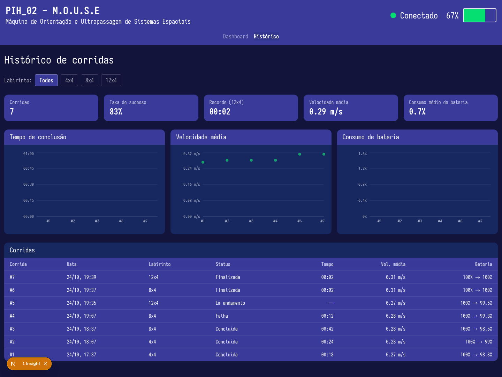

# Testes de Software

### Teste de integração frontend ↔ backend: Histórico de corridas (HU-04 / RF-14)

- **Rastreabilidade:** HU-04 (Consulta e filtro de histórico), RF-14 (Persistência e histórico de corridas), RF-15 (destaque do melhor tempo por labirinto). Casos de teste CT-10 e CT-11 (ver _4.4 - Projeto conceitual de software_).
- **Objetivo:** validar que a tela `/historico` deixou de usar os dados fixos de `mock-corridas.ts` e passou a consumir a API REST do backend NestJS, que lê as corridas gravadas no PostgreSQL.

**Rotas integradas**

| Rota                                    | Uso na tela                                                                 |
| --------------------------------------- | --------------------------------------------------------------------------- |
| `GET /runs`                             | Tabela, indicadores e gráficos com todas as corridas (filtro "Todos")       |
| `GET /runs?mazeId=4x4` / `8x4` / `12x4` | Mesma tela filtrada por labirinto; o filtro é aplicado na consulta ao banco |
| `GET /runs/best`                        | Card "Recorde" (menor tempo por labirinto)                                  |

O backend calcula, a partir das telemetrias de cada corrida, a velocidade média (`speed_mm_s` → m/s) e a bateria inicial e final (`battery_pct` da primeira e da última amostra). O frontend busca os dados no servidor do Next (`src/frontend/src/lib/corridas.ts`), e os botões de filtro mudam a URL (`/historico?labirinto=8x4`), o que dispara uma nova consulta.

**Ambiente**

| Serviço            | Endereço                                                             |
| ------------------ | -------------------------------------------------------------------- |
| Frontend (Next.js) | `http://localhost:3000/historico`                                    |
| API REST (NestJS)  | `http://localhost:3002` (`PORT` em `src/backend/.env.development`)   |
| Ingestão WebSocket | `ws://localhost:3001/ingest`                                         |
| Banco              | PostgreSQL com as migrações do Prisma e o _seed_ (`npm run db:seed`) |

**Pré-condições:** banco populado pelo _seed_ (corridas em 4x4 e 8x4) e com corridas reais geradas pelo emulador do robô (`npm run robot:emulator -- --maze 8x4` e `--maze 12x4`). O evento `RUN_START` do emulador passou a informar o labirinto (`maze`), para que a corrida seja gravada na dimensão certa.

**Procedimento**

1. Conferir o JSON das rotas com `curl http://localhost:3002/runs`, `curl "http://localhost:3002/runs?mazeId=8x4"` e `curl http://localhost:3002/runs/best`.
2. Acessar `http://localhost:3000/historico` e conferir a tabela com o filtro "Todos".
3. Selecionar os filtros 4x4, 8x4 e 12x4 e conferir a tabela e o card "Recorde".
4. Voltar ao filtro "Todos".

**Resultado obtido** (24/10/2026)

| Filtro | Corridas exibidas                | Status                                     | Recorde      | Conferência com o banco                            |
| ------ | -------------------------------- | ------------------------------------------ | ------------ | -------------------------------------------------- |
| Todos  | 7                                | Concluída, Finalizada, Falha, Em andamento | 00:02 (12x4) | `GET /runs` → 7 corridas                           |
| 4x4    | 2                                | Concluída                                  | 00:18        | `GET /runs?mazeId=4x4` → 2; `/runs/best` → 18,4 s  |
| 8x4    | 3 (inclui a corrida do emulador) | Concluída, Falha, Finalizada               | 00:02        | `GET /runs?mazeId=8x4` → 3; `/runs/best` → 2,52 s  |
| 12x4   | 2 (corridas do emulador)         | Finalizada, Em andamento                   | 00:02        | `GET /runs?mazeId=12x4` → 2; `/runs/best` → 2,51 s |

Em todos os filtros a tabela mostrou exatamente as corridas devolvidas pela API, e o card de recorde coincidiu com `GET /runs/best`. Quando um labirinto não tem corridas, a tabela exibe "Nenhuma corrida registrada para o labirinto …" (CT-11). Os testes unitários de `RunsService.findAll` (métricas agregadas, corrida sem telemetria e filtro por `mazeId`) passam com `npm test` no backend.

