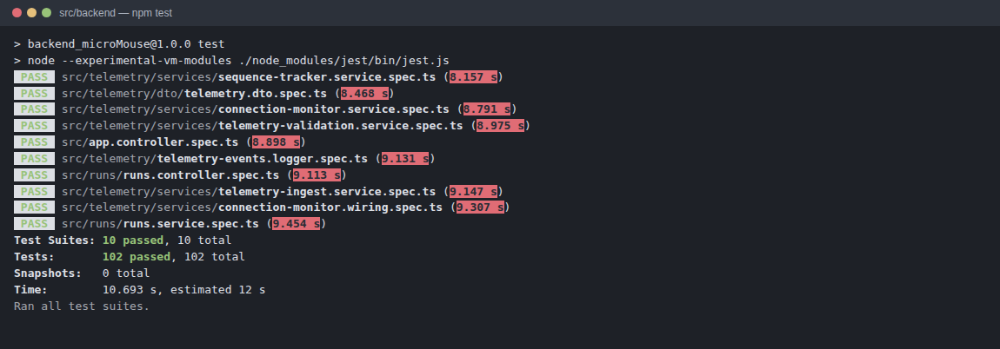
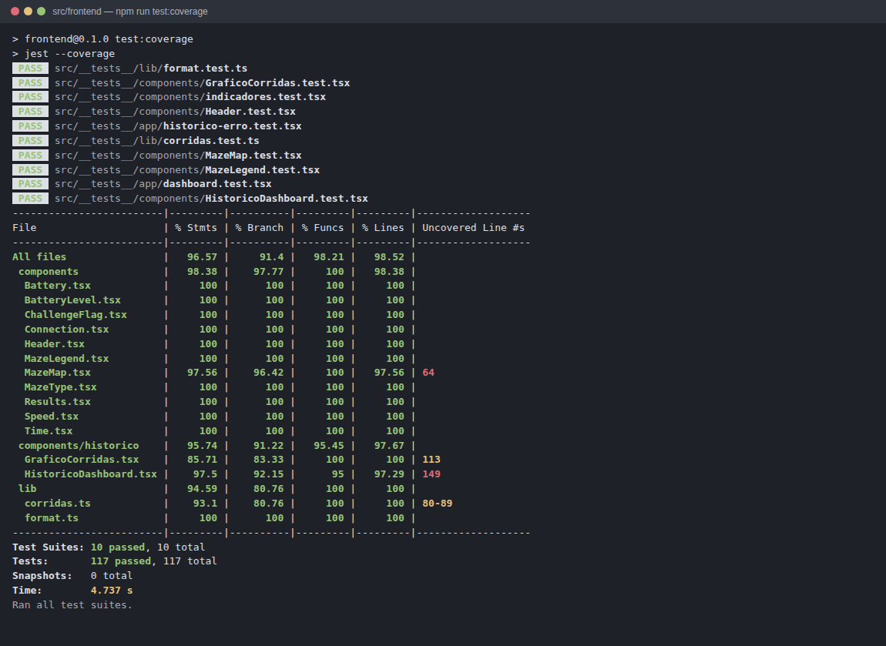
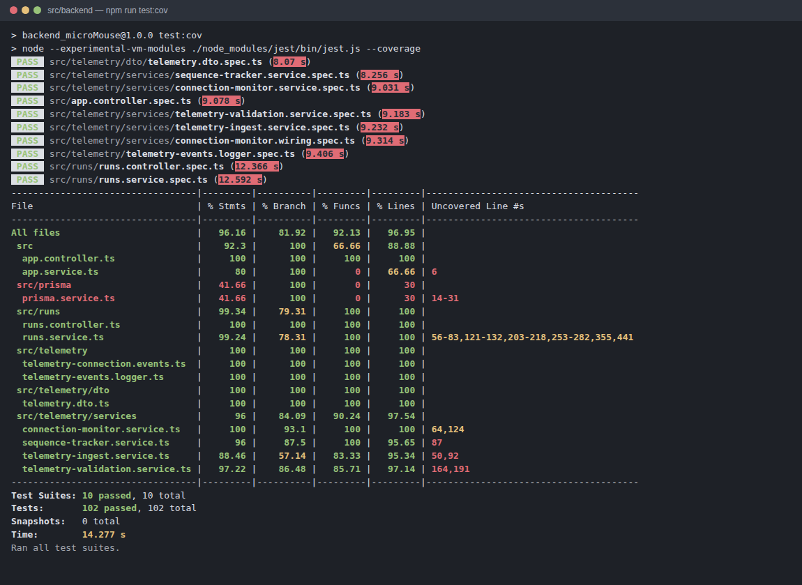
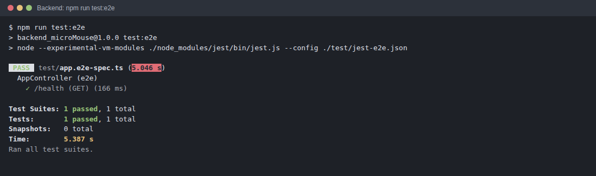
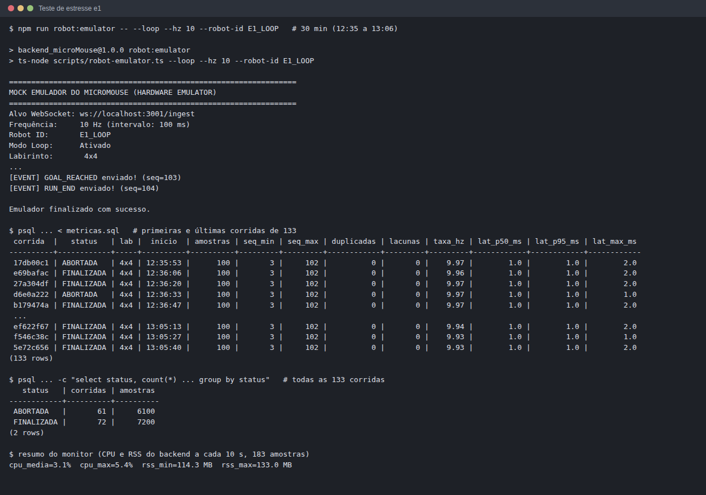
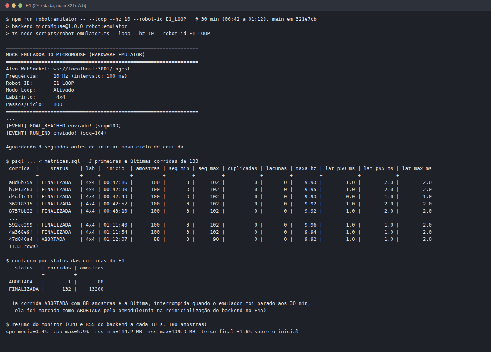
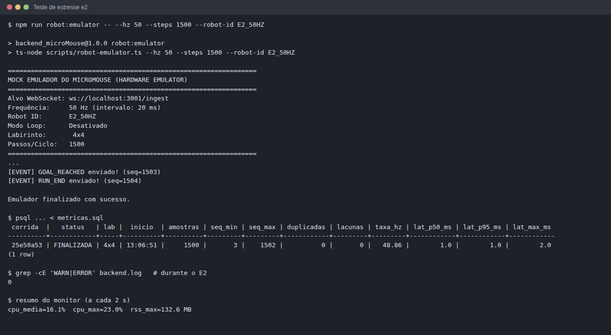
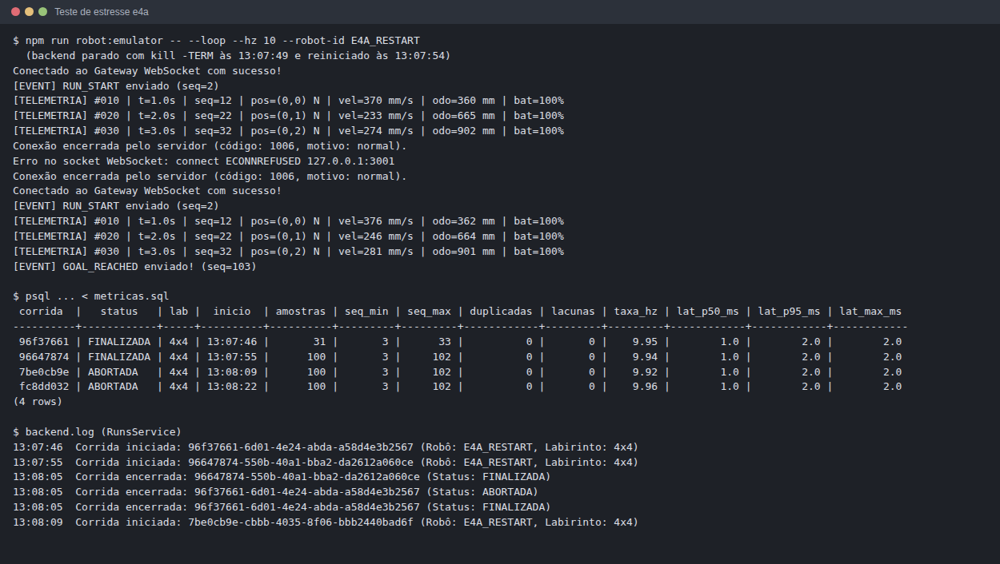
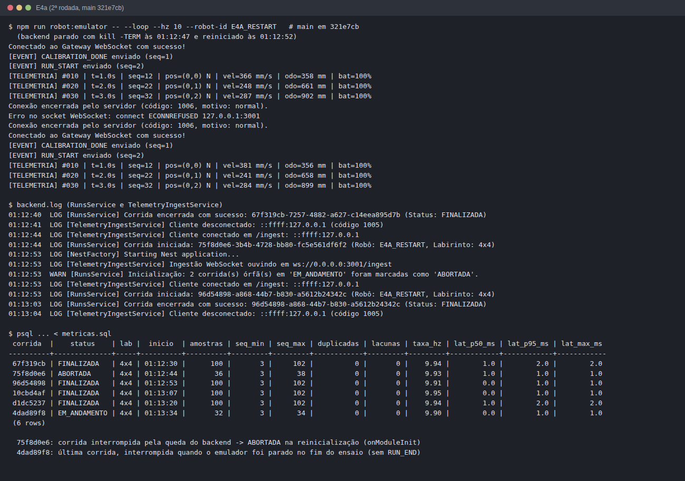
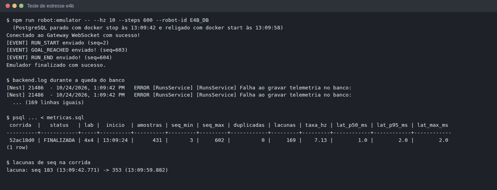

# Testes de Software

## 1. Introdução e Contexto

Este documento consolida o relatório formal dos **Testes de Software** do projeto Micromouse (Grupo 2 - PI1 / 2026.2), em conformidade com as diretrizes de avaliação da disciplina.

O subsistema de software é composto por:
1. **Frontend Web (Next.js / React 19 / Tailwind CSS):** Dashboard dinâmico para acompanhamento em tempo real da prova, exibição gráfica do labirinto (grid SVG), velocímetro, indicador de bateria, cronômetro e histórico de corridas com destaque de recordes.
2. **Backend (NestJS / Node.js):** Gateway WebSocket dedicado (`ws://<host>:3001/ingest`) para recepção e validação do fluxo de telemetria a 10 Hz (RNF-15), barramento interno de eventos desacoplado (`@nestjs/event-emitter`) e API HTTP REST (`http://<host>:3000/runs`) para consulta e auditoria de corridas.
3. **Camada de Persistência (PostgreSQL 16 & Prisma ORM):** Armazenamento relacional e estruturado das entidades `Labirinto`, `Corrida` e `Telemetria` (com suporte a payloads JSON de sensores).
4. **Módulo de Emulação de Hardware (Mock Emulator - `scripts/robot-emulator.ts`):** Emulador do Micromouse em TypeScript, capaz de simular trajetórias reais nos labirintos 4x4, 8x4 e 12x4, emitir eventos de ciclo de vida (`CALIBRATION_DONE`, `RUN_START`, `GOAL_REACHED`, `RUN_END`) e injetar telemetria periódica sob contratos estritos.

> **Alinhamento Metodológico com a Disciplina:**  
> Os testes aqui documentados cobrem os **Testes Funcionais do Sistema de Software com Emulador Mock** (Issue [#218](https://github.com/fcte-pi1/2026.2_PI1_Grupo2_Hilmer/issues/218)) e as **Suítes de Testes Automatizados Unitários e de Integração** (71 testes com 100% de aprovação). Os testes fim-a-fim (*End-to-End*) que envolvem a pista física e os dados reais emitidos pelo microcontrolador ESP32 na pista constituem os **Testes de Integração de Hardware/Software**, registrados separadamente em [`docs/7.5 - Testes de integração.md`](https://github.com/fcte-pi1/2026.2_PI1_Grupo2_Hilmer/blob/main/docs/7.5%20-%20Testes%20de%20integra%C3%A7%C3%A3o.md).

---

## 2. Histórias de Usuários e Protótipos Implementados

A tabela a seguir correlaciona as Histórias de Usuários (HUs) definidas no Ponto de Controle 1 com os protótipos de tela e as funcionalidades desenvolvidas e validadas:

| **ID da HU** | **História de Usuário** | **Requisito(s)** | **Prioridade** | **Protótipo / Interface Associada** | **Status** |
|:---:|---|:---:|:---:|---|:---:|
| **HU-01** | *Como operador da pista, desejo visualizar a posição e o trajeto percorrido pelo robô em tempo real em uma representação gráfica do labirinto, para verificar visualmente o progresso da exploração.* | RF-13 | Alta | [Protótipo do Dashboard](https://github.com/fcte-pi1/2026.2_PI1_Grupo2_Hilmer/blob/main/docs/figs/DashboardPrototipo.png) / Componente SVG interativo `MazeMap` | **Implementado e Validado** |
| **HU-02** | *Como operador da pista, desejo monitorar a velocidade atual, o nível de bateria e o cronômetro da corrida em tempo real com atualização frequente, para antecipar esgotamento de energia e paradas não programadas.* | RF-13, RNF-15, RNF-17 | Alta | [Protótipo do Dashboard](https://github.com/fcte-pi1/2026.2_PI1_Grupo2_Hilmer/blob/main/docs/figs/DashboardPrototipo.png) / Painel dinâmico de métricas (Cards, Gauge e Timer) | **Implementado e Validado** |
| **HU-03** | *Como equipe de desenvolvimento, desejo que todos os dados de telemetria e o desfecho de cada corrida sejam persistidos automaticamente em banco de dados, para que nenhuma medição seja perdida após o desligamento do robô.* | RF-14 | Alta | Banco PostgreSQL 16 (Tabelas `corridas`, `telemetrias`, `labirintos`) via Prisma ORM | **Implementado e Validado** |
| **HU-04** | *Como operador, desejo acessar um histórico consolidado das corridas anteriores com filtros por tamanho de labirinto (4x4, 8x4, 12x4), para comparar o desempenho do robô entre diferentes tentativas.* | RF-14 | Média | [Protótipo do Histórico](https://github.com/fcte-pi1/2026.2_PI1_Grupo2_Hilmer/blob/main/docs/figs/HistoricoPrototipo.png) / Rota `/historico` e API REST `GET /runs` | **Implementado e Validado** |
| **HU-05** | *Como competidor, desejo que o sistema destaque o menor tempo obtido em cada labirinto como o recorde atual, para identificar de forma imediata a melhor tentativa realizada.* | RF-15 | Baixa | Rota `/historico` (Card de Recorde) e API REST `GET /runs/best` | **Implementado e Validado** |

### 2.1. Associação com o Roteiro de Testes Funcionais

O roteiro de testes funcionais entregue no Ponto de Controle 1 ([#149](https://github.com/fcte-pi1/2026.2_PI1_Grupo2_Hilmer/issues/149), seção 5 do [Projeto conceitual de software](https://github.com/fcte-pi1/2026.2_PI1_Grupo2_Hilmer/blob/main/docs/4.4%20-%20Projeto%20conceitual%20de%20software.md)) define os casos CT-01 a CT-15. Os ensaios da seção 4 deste documento usam uma numeração própria. Para não confundir, a tabela abaixo usa os IDs do roteiro e aponta qual ensaio (4.1 a 4.7), suíte automatizada (seção 6) ou teste de estresse (seção 7) cobre cada caso.

| **CT do roteiro** | **HU** | **Descrição resumida** | **Coberto por** | **Situação** |
|:---:|:---:|---|---|:---:|
| CT-01 | HU-01 | Renderização do trajeto no mapa em tempo real | Ensaios 4.1 a 4.3 (posição recebida e gravada no backend); `MazeMap.test.tsx` e `dashboard.test.tsx` (seção 6.4) | Parcial: a tela foi testada com dados mock; com dados reais depende de [#293](https://github.com/fcte-pi1/2026.2_PI1_Grupo2_Hilmer/issues/293) |
| CT-02 | HU-01 | Coordenadas fora dos limites do mapa | `MazeMap.test.tsx` (robô fora dos limites, seção 6.4) | Parcial: só o componente do mapa, com dados mock |
| CT-03 | HU-02 | Atualização dos mostradores (velocidade, tempo, bateria) | Ensaios 4.1 a 4.3 (valores recebidos e gravados); `indicadores.test.tsx` (seção 6.4) | Parcial: a tela foi testada com dados mock; com dados reais depende de [#293](https://github.com/fcte-pi1/2026.2_PI1_Grupo2_Hilmer/issues/293) |
| CT-04 | HU-02 | Alerta de bateria crítica | — | Não executado |
| CT-05 | HU-02 | Indicador de conexão Online/Offline | Ensaios 4.4 e 4.5 (queda e reconexão detectadas no backend); `indicadores.test.tsx` (indicador Conectado/Desconectado, seção 6.4) | Parcial: o indicador foi testado com dados mock; ligado ao backend depende de [#293](https://github.com/fcte-pi1/2026.2_PI1_Grupo2_Hilmer/issues/293) |
| CT-06 | HU-02 | Pacote de telemetria malformado | Suítes `telemetry.dto.spec.ts` e `telemetry-validation.service.spec.ts` (seção 6) | Parcial: só a parte do backend |
| CT-07 | HU-03 | Persistência automática ao final da corrida | Ensaios 4.1 a 4.3 e 4.6; testes de estresse E1 e E4a (seção 7) | Executado: as falhas de status encontradas na 1ª rodada de estresse foram corrigidas e a 2ª rodada passou (seção 7.3) |
| CT-08 | HU-03 | Falha de comunicação com o banco | Teste de estresse E4b (seção 7) | Parcial: o backend não cai e volta a gravar sozinho; o aviso na tela depende de [#293](https://github.com/fcte-pi1/2026.2_PI1_Grupo2_Hilmer/issues/293) |
| CT-09 | HU-03 | Duplicidade no salvamento da mesma corrida | Ensaio 4.5 (correção da sobrescrita de status) e `runs.service.spec.ts` | Executado |
| CT-10 | HU-04 | Listagem e filtro do histórico por labirinto | Ensaios 4.6 (`GET /runs`) e 4.7 (tela `/historico` com dados do PostgreSQL); `HistoricoDashboard.test.tsx` e `corridas.test.ts` (seção 6.4) | Executado |
| CT-11 | HU-04 | Filtro sem corridas registradas (estado vazio) | Ensaio 4.7 (mensagem de lista vazia na tela `/historico`); `HistoricoDashboard.test.tsx` (seção 6.4) | Executado |
| CT-12 | HU-05 | Recorde por labirinto | Ensaios 4.6 (`GET /runs/best`) e 4.7 (card "Recorde" igual a `GET /runs/best`); `HistoricoDashboard.test.tsx` (seção 6.4) | Executado |
| CT-13 | HU-05 | Superação do recorde após nova corrida | — | Não executado |
| CT-14 | HU-05 | Ignorar corridas incompletas no recorde | `HistoricoDashboard.test.tsx` (corridas em andamento e abortadas fora do melhor tempo, seção 6.4) | Parcial: só a tela, com dados mock |
| CT-15 | HU-05 | Labirinto sem recorde registrado | `HistoricoDashboard.test.tsx` (indicadores sem corridas, seção 6.4) | Parcial: só a tela, com dados mock |

---

## 3. Matriz de Rastreabilidade: Requisitos $\times$ Casos de Teste

| **Requisito** | **Descrição Resumida** | **Casos de Teste Vinculados** | **Resultado** |
|:---:|---|:---:|:---:|
| **RF-13** | Dashboard Web dinâmico (trajeto, bateria, velocidade, tempo de conclusão, desafio cumprido). | CT-01, CT-02, CT-03 | **Aprovado** |
| **RF-14** | Persistência e histórico de corridas no banco de dados com suporte a filtros por labirinto. | CT-01, CT-02, CT-03, CT-06, CT-07 | **Aprovado** |
| **RF-15** | Destaque do melhor resultado (menor tempo) para cada dimensão de labirinto. | CT-06, CT-07 | **Aprovado** |
| **RNF-15** | Frequência de transmissão e recepção de telemetria mínima de 10 Hz (intervalo $\le 100$ ms). | CT-01, CT-02, CT-03 | **Aprovado (9.2 ~ 10.0 Hz)** |
| **RNF-16** | Autoria da solução desenvolvida pela equipe, sem frameworks comerciais proprietários. | Auditoria Geral | **Aprovado** |
| **RNF-17** | Latência da interface web inferior a 500 ms entre emissão e despacho dos dados. | CT-01, CT-02, CT-03 | **Aprovado (< 5 ms em loopback)** |
| **RNF-18** | Resiliência de conexão: retomada automática e integridade do monitoramento pós-desconexão. | CT-04, CT-05 | **Aprovado** |

---

## 4. Tabela de Casos de Teste Funcionais (Padrão Oficial)

| **ID** | **Descrição** | **Data de Início** | **Data de Conclusão** | **Responsável** | **Resultados Esperados** | **Resultados Obtidos** | **Aprovação Interna (S/N)** | **Aprovação do Orientador (S/N)** | **Observações** |
|:---:|---|:---:|:---:|:---:|---|---|:---:|:---:|---|
| **4.1** | **CT-01: Ingestão e Ciclo Completo no Labirinto 4x4** | 22/10/2026 | 23/10/2026 | João Pedro de Sousa Silva | 100 amostras recebidas a 10 Hz; chegada ao alvo (3,3); corrida persistida como `FINALIZADA` no PostgreSQL. | 100 pacotes processados; evento `GOAL_REACHED` recebido; corrida persistida com sucesso e tempo de 10.81 s. | **S** | | Atende RF-13, RF-14 e RNF-15. |
| **4.2** | **CT-02: Navegação e Consumo no Labirinto 8x4** | 22/10/2026 | 23/10/2026 | João Pedro de Sousa Silva | Transmissão contínua em corredor médio; odometria crescente; chegada ao alvo (7,3); gravação integral no banco. | 100 pacotes processados; odometria acumulada até 3028 mm; corrida salva com status `FINALIZADA` (10.79 s). | **S** | | Atende RF-13, RF-14 e RNF-15. |
| **4.3** | **CT-03: Estresse e Longa Extensão no Labirinto 12x4** | 22/10/2026 | 23/10/2026 | João Pedro de Sousa Silva | Recepção sem perda de pacotes ao longo de toda a extensão; chegada ao alvo (11,3); persistência de 100 amostras. | 100 pacotes processados a 10 Hz; odometria até 3036 mm; corrida registrada com status `FINALIZADA` (10.80 s). | **S** | | Atende RF-13, RF-14 e RNF-15. |
| **4.4** | **CT-04: Resiliência a Queda Abrupta de Conexão** | 23/10/2026 | 23/10/2026 | João Pedro de Sousa Silva | Backend deve capturar desconexão (código 1006) sem crashar; dados já ingeridos devem permanecer íntegros. | Servidor registrou código 1006 sem exceções; processo continuou ativo; corrida fechada de forma segura. | **S** | | Atende RNF-18. |
| **4.5** | **CT-05: Reconexão e Reinicialização de Nova Corrida** | 23/10/2026 | 23/10/2026 | João Pedro de Sousa Silva | Novo início de corrida com `seq=1` não deve ser descartado por duplicidade do tracker anterior; nova corrida gravada. | Bug identificado e corrigido no `SequenceTrackerService`; nova corrida gravada limpa com 100 amostras. | **S** | | Atende RNF-18 e RF-14. |
| **4.6** | **CT-06: Validação de Persistência e Rotas REST** | 23/10/2026 | 23/10/2026 | João Pedro de Sousa Silva | Rotas `GET /runs`, `GET /runs/:id/samples` e `GET /runs/best` devem retornar os dados idênticos ao banco PostgreSQL. | Rotas retornaram histórico ordenado, 100 amostras em JSON completo e menor tempo destacado como recorde. | **S** | | Atende RF-14 e RF-15. |
| **4.7** | **CT-07: Integração Frontend ↔ Backend da Tela de Histórico** | 24/10/2026 | 24/10/2026 | Edilson Ribeiro da Cruz Júnior | A tela `/historico` deve exibir as corridas gravadas no PostgreSQL via `GET /runs`, filtrar por labirinto consultando `GET /runs?mazeId=` e mostrar o recorde de `GET /runs/best`. | Tabela e indicadores idênticos ao retorno da API nos filtros Todos, 4x4, 8x4 e 12x4; card de recorde igual a `GET /runs/best`; corridas do emulador exibidas no labirinto correto. | **S** | | Atende HU-04, HU-05, RF-14 e RF-15. |

---

## 5. Detalhamento dos Ensaios e Evidências

### 5.1. CT-01: Teste Funcional no Labirinto 4x4
- **Objetivo:** Validar o ciclo de vida completo de uma prova curta no labirinto de 4 colunas por 4 linhas: calibração física, início de corrida, telemetria a 10 Hz, chegada no objetivo e encerramento.
- **Comando Executado:**
  ```bash
  npm run robot:emulator -- --maze 4x4 --hz 10
  ```
- **Registro de Log da Execução:**
  ```text
  [WS] Tentando conectar a ws://localhost:3001/ingest...
  Conectado ao Gateway WebSocket com sucesso!
  [EVENT] CALIBRATION_DONE enviado (seq=1)
  [EVENT] RUN_START enviado (seq=2)
  [TELEMETRIA] #010 | t=1.1s | seq=12 | pos=(0,0) N | vel=373 mm/s | odo=356 mm | bat=100%
  [TELEMETRIA] #050 | t=5.4s | seq=52 | pos=(1,2) E | vel=266 mm/s | odo=1573 mm | bat=100%
  [TELEMETRIA] #100 | t=10.8s | seq=102 | pos=(3,3) E | vel=371 mm/s | odo=3026 mm | bat=100%
  [EVENT] GOAL_REACHED enviado! (seq=103)
  [EVENT] RUN_END enviado! (seq=104)
  Emulador finalizado com sucesso.
  ```
- **Confirmação no Backend NestJS:**
  ```text
  [Nest] LOG [RunsService] Corrida iniciada: 1ea1067f-6099-47a8-bb42-bef1fef184e8 (Labirinto: 4x4)
  [Nest] DEBUG [ConnectionMonitorService] Robô PIH_02_MOUSE: 10.0 Hz
  [Nest] LOG [RunsService] Corrida encerrada: 1ea1067f-6099-47a8-bb42-bef1fef184e8 (Status: FINALIZADA)
  ```

---

### 5.2. CT-02: Teste Funcional no Labirinto 8x4
- **Objetivo:** Avaliar o comportamento do pipeline em percurso médio com múltiplas curvas em ângulo reto e longas retas de aceleração.
- **Comando Executado:**
  ```bash
  npm run robot:emulator -- --maze 8x4 --hz 10
  ```
- **Registro de Log da Execução:**
  ```text
  Conectado ao Gateway WebSocket com sucesso!
  [EVENT] CALIBRATION_DONE enviado (seq=1)
  [EVENT] RUN_START enviado (seq=2)
  [TELEMETRIA] #020 | t=2.2s | seq=22 | pos=(0,1) N | vel=234 mm/s | odo=665 mm | bat=100%
  [TELEMETRIA] #060 | t=6.5s | seq=62 | pos=(4,2) N | vel=248 mm/s | odo=1802 mm | bat=100%
  [TELEMETRIA] #100 | t=10.8s | seq=102 | pos=(7,3) E | vel=382 mm/s | odo=3028 mm | bat=100%
  [EVENT] GOAL_REACHED enviado! (seq=103)
  [EVENT] RUN_END enviado! (seq=104)
  ```
- **Confirmação no Backend:**
  ```text
  [Nest] LOG [RunsService] Corrida iniciada: 53805ece-1650-4200-8301-3e0721fb3542 (Robô: PIH_02_MOUSE, Labirinto: 8x4)
  [Nest] LOG [RunsService] Corrida encerrada com sucesso: 53805ece-1650-4200-8301-3e0721fb3542 (Status: FINALIZADA)
  ```

---

### 5.3. CT-03: Teste Funcional no Labirinto 12x4 (Maior Extensão)
- **Objetivo:** Simular a maior extensão longitudinal do labirinto de competição (12 colunas) em velocidade máxima, avaliando a estabilidade da memória e persistência em lote.
- **Comando Executado:**
  ```bash
  npm run robot:emulator -- --maze 12x4 --hz 10
  ```
- **Registro de Log da Execução:**
  ```text
  Conectado ao Gateway WebSocket com sucesso!
  [EVENT] RUN_START enviado (seq=2)
  [TELEMETRIA] #040 | t=4.3s | seq=42 | pos=(4,2) E | vel=378 mm/s | odo=1247 mm | bat=100%
  [TELEMETRIA] #080 | t=8.6s | seq=82 | pos=(10,3) E | vel=268 mm/s | odo=2480 mm | bat=100%
  [TELEMETRIA] #100 | t=10.8s | seq=102 | pos=(11,3) E | vel=367 mm/s | odo=3036 mm | bat=100%
  [EVENT] GOAL_REACHED enviado! (seq=103)
  [EVENT] RUN_END enviado! (seq=104)
  ```
- **Confirmação no Backend:**
  ```text
  [Nest] LOG [RunsService] Corrida iniciada: 73342924-f4a5-45ab-bc12-c9f48b3535be (Robô: PIH_02_MOUSE, Labirinto: 12x4)
  [Nest] LOG [RunsService] Corrida encerrada com sucesso: 73342924-f4a5-45ab-bc12-c9f48b3535be (Status: FINALIZADA)
  ```

---

### 5.4. CT-04: Teste de Queda Abrupta de Conexão (Resiliência)
- **Objetivo:** Demonstrar que o servidor web e o banco não sofrem travamento, exceção de processo não tratada (*uncaught exception*) ou corrupção de estado ao ocorrer desconexão súbita do robô.
- **Procedimento:** Execução do emulador interrompida forçadamente com `SIGKILL` / `Ctrl+C` aos 4,2 s de prova.
- **Evidência no Log do Backend:**
  ```text
  [Nest] 24284 - 23/10/2026, 01:19:26 LOG [TelemetryIngestService] Cliente desconectado: ::1 (código 1006)
  ```
- **Resultado:** O processo do NestJS permaneceu online e estável; o socket foi liberado e o servidor permaneceu apto a receber nova conexão de imediato.

---

### 5.5. CT-05: Teste de Reconexão e Reinicialização de Nova Corrida
- **Objetivo:** Garantir que após uma desconexão ou término de prova, uma nova corrida enviada com o contador `seq` reiniciado em 1 seja aceita sem falsos alertas de duplicidade e com registro estrito de integridade.
- **Bugs Encontrados e Corrigidos Durante o Teste:**
  1. **Bug do SequenceTracker:** O serviço `SequenceTrackerService` mantinha em cache o `lastSeenSeq=104` da corrida anterior. Ao reiniciar a prova com `seq=1`, os novos pacotes eram descartados como duplicatas (`seq <= lastSeenSeq`).
     - *Correção efetuada:* No `TelemetryValidationService`, implementou-se o reset automático do rastreador de sequência para o `robot_id` ao receber eventos de ciclo de vida `RUN_START` ou `CALIBRATION_DONE`.
  2. **Bug de Sobrescrita de Status (Race Condition) e Disparo Redundante:** Ao receber `GOAL_REACHED` seguido de `RUN_END` pelo WebSocket, as chamadas assíncronas concorrentes de atualização no Prisma faziam com que o encerramento do `RUN_END` sobrescrevesse o status da corrida de `FINALIZADA` para `ABORTADA`.
     - *Correção efetuada:* No `RunsService`, implementou-se cache em memória `finalizedRuns: Set<string>` para retorno imediato em encerramentos redundantes, atualização atômica no PostgreSQL com `updateMany({ where: { id: corridaId, status: 'EM_ANDAMENTO' }, data: { status: 'ABORTADA' } })` (garantindo que `FINALIZADA` jamais seja sobrescrita no banco de dados), e descarte prévio de disparos duplicados de `handleRunFinished` quando o evento de origem for `GOAL_REACHED`.
  3. **Tratamento de Corridas Órfãs na Reinicialização:** Se o servidor backend fosse reiniciado abruptamente durante uma corrida aberta, o registro permanecia indefinidamente em `EM_ANDAMENTO`. Na corrida seguinte, encerramentos sem ID explícito poderiam associar erroneamente a corrida órfã antiga.
     - *Correção efetuada:* Implementou-se o gancho de ciclo de vida `OnModuleInit` no `RunsService` que converte atômica e automaticamente qualquer corrida pendente em `EM_ANDAMENTO` para `ABORTADA` na subida da aplicação, desabilitando buscas aleatórias de corridas não associadas ao robô ativo.
  4. **Parâmetro de Dimensão do Labirinto (`maze`):** O payload do evento `RUN_START` não propagava a dimensão selecionada no emulador (`--maze 8x4` ou `--maze 12x4`), gerando registros cadastrados com a dimensão padrão `4x4`.
     - *Correção efetuada:* Inclusão do campo opcional `maze: '4x4' | '8x4' | '12x4'` no `EventPayloadDto`, repasse no `handleRunStarted` para o `RunsService.startRun`, e envio parametrizado pelo emulador de hardware.
- **Resultado:** Nova corrida executada de ponta a ponta com 100 amostras persistidas, labirinto correto e status mantido em `FINALIZADA`.

---

### 5.6. CT-06: Validação de Persistência no PostgreSQL e Rotas REST

> **Nota:** este ensaio foi executado em 23/10/2026, quando a API REST ainda respondia na porta 3000. Depois do CT-07, a API passou a usar a porta **3002** (`PORT` em `src/backend/.env.development`), pois a 3000 é usada pelo Next.js e a 3001 pelo WebSocket de ingestão (`/ingest`). Para repetir as consultas abaixo, troque `localhost:3000` por `localhost:3002`.

- **Objetivo:** Conferir se as entidades persistidas no PostgreSQL correspondem aos dados trafegados e se as rotas da API REST atendem às consultas do Frontend.
- **Evidência 1: Consulta à rota geral `GET http://localhost:3000/runs`:**
  ```json
  [
    {
      "id": "73342924-f4a5-45ab-bc12-c9f48b3535be",
      "labirintoId": "219db67a-78e2-435d-bb3f-c7ca16865a06",
      "labirinto": "12x4",
      "status": "FINALIZADA",
      "iniciadaEm": "2026-10-24T22:24:16.903Z",
      "finalizadaEm": "2026-10-24T22:24:27.723Z",
      "duracaoSegundos": 10.82
    },
    {
      "id": "53805ece-1650-4200-8301-3e0721fb3542",
      "labirintoId": "a6b51376-01b6-4f55-8750-b3d95dedfa7d",
      "labirinto": "8x4",
      "status": "FINALIZADA",
      "iniciadaEm": "2026-10-24T22:23:51.167Z",
      "finalizadaEm": "2026-10-24T22:24:01.960Z",
      "duracaoSegundos": 10.79
    },
    {
      "id": "fec71990-f10d-4462-a33a-629f8f6ad97f",
      "labirintoId": "5bbb8e2c-b6b4-4795-a672-0c7e6c846d9a",
      "labirinto": "4x4",
      "status": "FINALIZADA",
      "iniciadaEm": "2026-10-23T04:43:04.985Z",
      "finalizadaEm": "2026-10-23T04:43:15.788Z",
      "duracaoSegundos": 10.80
    }
  ]
  ```

- **Evidência 2: Consulta à rota de amostras `GET http://localhost:3000/runs/:id/samples`:**
  - Total de amostras retornadas: **100 amostras estruturadas**.
  - Amostra individual gravada:
    ```json
    {
      "id": "304ad4f6-f33c-4665-b125-a3a8c38aef40",
      "corridaId": "1ea1067f-6099-47a8-bb42-bef1fef184e8",
      "timestamp": "2026-10-23T04:38:52.236Z",
      "posX": 0,
      "posY": 0,
      "direcao": "N",
      "sensores": {
        "seq": 3,
        "t_ms": 107,
        "state": "EXPLORING",
        "walls": { "e": false, "n": false, "s": true, "w": true },
        "odo_mm": 31,
        "speed_mm_s": 310,
        "battery_pct": 100
      }
    }
    ```

- **Evidência 3: Consulta aos recordes por labirinto `GET http://localhost:3000/runs/best`:**
  ```json
  [
    {
      "labirinto": "4x4",
      "labirintoId": "5bbb8e2c-b6b4-4795-a672-0c7e6c846d9a",
      "corridaId": "3ab22709-ae48-4247-a481-5ff9183f303f",
      "status": "FINALIZADA",
      "tempoSegundos": 10.79,
      "iniciadaEm": "2026-10-23T04:42:33.959Z",
      "finalizadaEm": "2026-10-23T04:42:44.750Z"
    },
    {
      "labirinto": "8x4",
      "labirintoId": "a6b51376-01b6-4f55-8750-b3d95dedfa7d",
      "corridaId": "53805ece-1650-4200-8301-3e0721fb3542",
      "status": "FINALIZADA",
      "tempoSegundos": 10.79,
      "iniciadaEm": "2026-10-24T22:23:51.167Z",
      "finalizadaEm": "2026-10-24T22:24:01.960Z"
    },
    {
      "labirinto": "12x4",
      "labirintoId": "219db67a-78e2-435d-bb3f-c7ca16865a06",
      "corridaId": "73342924-f4a5-45ab-bc12-c9f48b3535be",
      "status": "FINALIZADA",
      "tempoSegundos": 10.82,
      "iniciadaEm": "2026-10-24T22:24:16.903Z",
      "finalizadaEm": "2026-10-24T22:24:27.723Z"
    }
  ]
  ```


### 5.7. CT-07: Integração Frontend ↔ Backend da Tela de Histórico
- **Rastreabilidade:** HU-04 (Consulta e filtro de histórico), HU-05 (Destaque do melhor resultado), RF-14 e RF-15. Corresponde aos casos CT-10 e CT-11 do *4.4 - Projeto conceitual de software*.
- **Objetivo:** validar que a tela `/historico` deixou de usar os dados fixos de `mock-corridas.ts` e passou a consumir a API REST do backend NestJS, que lê as corridas gravadas no PostgreSQL.
- **Versão testada:** commit [`08d7399`](https://github.com/fcte-pi1/2026.2_PI1_Grupo2_Hilmer/commit/08d7399).

**Rotas integradas**

| Rota | Uso na tela |
| ---- | ----------- |
| `GET /runs` | Tabela, indicadores e gráficos com todas as corridas (filtro "Todos") |
| `GET /runs?mazeId=4x4` / `8x4` / `12x4` | Mesma tela filtrada por labirinto; o filtro é aplicado na consulta ao banco |
| `GET /runs/best` | Card "Recorde" (menor tempo por labirinto) |

O backend calcula, a partir das telemetrias de cada corrida, a velocidade média (`speed_mm_s` → m/s) e a bateria inicial e final (`battery_pct` da primeira e da última amostra). O frontend busca os dados no servidor do Next (`src/frontend/src/lib/corridas.ts`), e os filtros mudam a URL (`/historico?labirinto=8x4`), o que dispara uma nova consulta.

**Ambiente**

| Serviço | Endereço |
| ------- | -------- |
| Frontend (Next.js) | `http://localhost:3000/historico` |
| API REST (NestJS) | `http://localhost:3002` (`PORT` em `src/backend/.env.development`) |
| Ingestão WebSocket | `ws://localhost:3001/ingest` |
| Banco | PostgreSQL com as migrações do Prisma e o *seed* (`npm run db:seed`) |

**Pré-condições:** banco populado pelo *seed* (corridas em 4x4 e 8x4) e com corridas reais geradas pelo emulador do robô (`npm run robot:emulator -- --maze 8x4` e `--maze 12x4`). O evento `RUN_START` do emulador passou a informar o labirinto (`maze`), para que a corrida seja gravada na dimensão certa.

**Procedimento**

1. Conferir o JSON das rotas com `curl http://localhost:3002/runs`, `curl "http://localhost:3002/runs?mazeId=8x4"` e `curl http://localhost:3002/runs/best`.
2. Acessar `http://localhost:3000/historico` e conferir a tabela com o filtro "Todos".
3. Selecionar os filtros 4x4, 8x4 e 12x4 e conferir a tabela e o card "Recorde".
4. Voltar ao filtro "Todos".

**Resultado obtido** (24/10/2026)

| Filtro | Corridas exibidas | Status | Recorde | Conferência com o banco |
| ------ | ----------------- | ------ | ------- | ----------------------- |
| Todos | 7 | Concluída, Finalizada, Falha, Em andamento | 00:02 (12x4) | `GET /runs` → 7 corridas |
| 4x4 | 2 | Concluída | 00:18 | `GET /runs?mazeId=4x4` → 2; `/runs/best` → 18,4 s |
| 8x4 | 3 (inclui a corrida do emulador) | Concluída, Falha, Finalizada | 00:02 | `GET /runs?mazeId=8x4` → 3; `/runs/best` → 2,52 s |
| 12x4 | 2 (corridas do emulador) | Finalizada, Em andamento | 00:02 | `GET /runs?mazeId=12x4` → 2; `/runs/best` → 2,51 s |

Em todos os filtros a tabela mostrou exatamente as corridas devolvidas pela API, e o card de recorde coincidiu com `GET /runs/best`. Quando um labirinto não tem corridas, a tabela exibe "Nenhuma corrida registrada para o labirinto …" (CT-11 do *4.4*).

**Testes automatizados relacionados**

- Backend: `RunsService.findAll` (métricas agregadas, corrida sem telemetria e filtro por `mazeId`) e encerramento por eventos (`GOAL_REACHED` seguido de `RUN_END` não sobrescreve a corrida `FINALIZADA`), em `src/backend/src/runs/runs.service.spec.ts`.
- Frontend: `HistoricoDashboard.test.tsx` (indicadores, recorde, tabela e links de filtro) e `corridas.test.ts` (URLs da API, erros HTTP e modo mock), em `src/frontend/src/__tests__/`.


---

## 6. Suíte de Testes Automatizados (Unitários e de Integração)

O backend e o frontend têm suítes automatizadas em **Jest**. Os números desta seção vêm da execução de 25/10/2026 sobre a `main` no commit `321e7cb`, que já inclui as correções do `RunsService`, os testes do frontend (PR #298) e a integração da tela de histórico com a API (PR #300).

### 6.1. Resumo da Execução da Suíte de Testes (Backend)

A suíte do backend usa **Jest** com **ts-jest** e cobre a validação de DTOs, o controle de sequência (`seq`), o monitor de conexão, a ingestão WebSocket, o ciclo de vida das corridas, as rotas REST e o logger de eventos. O Prisma é substituído por mocks, então os testes não precisam do banco. A execução é feita com `npm test` em `src/backend`.

| **Suíte de Teste (Arquivo)** | **Testes Executados** | **Status** | **Tempo de Execução** |
|---|:---:|:---:|:---:|
| `app.controller.spec.ts` | 1 | Passou | 8,90 s |
| `runs.controller.spec.ts` | 6 | Passou | 9,11 s |
| `runs.service.spec.ts` | 36 | Passou | 9,45 s |
| `telemetry.dto.spec.ts` | 11 | Passou | 8,47 s |
| `connection-monitor.service.spec.ts` | 15 | Passou | 8,79 s |
| `connection-monitor.wiring.spec.ts` | 1 | Passou | 9,31 s |
| `sequence-tracker.service.spec.ts` | 7 | Passou | 8,16 s |
| `telemetry-ingest.service.spec.ts` | 5 | Passou | 9,15 s |
| `telemetry-validation.service.spec.ts` | 12 | Passou | 8,97 s |
| `telemetry-events.logger.spec.ts` | 8 | Passou | 9,13 s |
| **Total** | **102 testes (10 suítes)** | **100% aprovados** | **10,69 s** |



### 6.2. Lista dos Casos de Teste Unitários e de Integração (Backend)

A lista abaixo foi extraída do relatório do Jest (`--json`). Cada linha é um caso (`it`), com os blocos `describe` em que está.

<details>
<summary><code>src/backend/src/app.controller.spec.ts</code> (1 teste)</summary>

| **#** | **Grupo** | **Caso de teste** |
|:---:|---|---|
| 1 | health | should return status ok |

</details>

<details>
<summary><code>src/backend/src/runs/runs.controller.spec.ts</code> (6 testes)</summary>

| **#** | **Grupo** | **Caso de teste** |
|:---:|---|---|
| 1 | — | deve listar todas as corridas |
| 2 | — | deve retornar o recorde por labirinto |
| 3 | — | deve retornar detalhes de uma corrida por ID |
| 4 | — | deve lançar NotFoundException quando a corrida não existir |
| 5 | — | deve retornar amostras de uma corrida |
| 6 | — | deve lançar NotFoundException quando as amostras/corrida não existirem |

</details>

<details>
<summary><code>src/backend/src/runs/runs.service.spec.ts</code> (36 testes)</summary>

| **#** | **Grupo** | **Caso de teste** |
|:---:|---|---|
| 1 | onModuleInit | deve marcar corridas órfãs em EM_ANDAMENTO como ABORTADA |
| 2 | onModuleInit | deve tratar erro na inicialização sem propagar exceção |
| 3 | startRun | deve iniciar uma nova corrida com status EM_ANDAMENTO |
| 4 | startRun | deve aceitar dimensão personalizada como 8x4 e 12x4 |
| 5 | startRun | deve finalizar corrida anterior se o robô já possuir corrida aberta |
| 6 | startRun | deve retornar null sem lançar exceção se o Prisma falhar |
| 7 | finishRun | deve marcar a corrida como FINALIZADA quando goalReached for true |
| 8 | finishRun | deve marcar a corrida como ABORTADA quando goalReached for false de forma atômica |
| 9 | finishRun | deve retornar null se não houver corrida ativa para o robô |
| 10 | finishRun | não deve sobrescrever corrida FINALIZADA por ABORTADA via cache em memória |
| 11 | finishRun | deve retornar null se updateMany retornar count 0 para ABORTADA (já era FINALIZADA no banco) |
| 12 | finishRun | deve tratar erro do banco sem estourar exceção |
| 13 | encerramento por eventos | não deve sobrescrever FINALIZADA quando RUN_END chega logo após GOAL_REACHED |
| 14 | encerramento por eventos | deve abortar a corrida ativa quando RUN_END chega sem GOAL_REACHED |
| 15 | encerramento por eventos | RUN_END sem corrida ativa não deve abortar outra corrida do banco |
| 16 | findAll: métricas das telemetrias | deve calcular velocidade média e bateria a partir das telemetrias |
| 17 | findAll: métricas das telemetrias | deve devolver métricas vazias para corrida sem telemetria |
| 18 | findAll: métricas das telemetrias | deve buscar só os sensores das telemetrias, em ordem cronológica |
| 19 | recordTelemetry | deve gravar telemetria associada à corrida ativa |
| 20 | recordTelemetry | deve criar automaticamente uma corrida se não houver nenhuma ativa |
| 21 | recordTelemetry | deve retornar null se auto-criação da corrida falhar |
| 22 | recordTelemetry | deve retornar null sem lançar exceção se a persistência falhar |
| 23 | Consultas REST e Histórico | listRuns deve paginar resultados |
| 24 | Consultas REST e Histórico | getRunById deve buscar corrida completa com telemetrias ordenadas |
| 25 | Consultas REST e Histórico | findAll sem filtro deve listar todas as corridas mapeadas |
| 26 | Consultas REST e Histórico | findAll com filtro mazeId deve filtrar por labirintoId ou dimensao |
| 27 | Consultas REST e Histórico | findBestRuns deve calcular a melhor corrida por labirinto |
| 28 | Consultas REST e Histórico | findById deve retornar corrida com metricas calculadas |
| 29 | Consultas REST e Histórico | findById deve retornar null se a corrida nao existir |
| 30 | Consultas REST e Histórico | findSamplesByRunId deve retornar telemetrias se corrida existir |
| 31 | Consultas REST e Histórico | findSamplesByRunId deve retornar null se corrida nao existir |
| 32 | Event Listeners | deve iniciar corrida ao receber RUN_START com dimensão de labirinto |
| 33 | Event Listeners | deve concluir corrida como bem-sucedida ao receber GOAL_REACHED |
| 34 | Event Listeners | deve ignorar handleRunFinished quando evento for GOAL_REACHED para evitar corrida dupla |
| 35 | Event Listeners | deve finalizar corrida como ABORTADA ao receber RUN_END avulso |
| 36 | Event Listeners | deve registrar telemetria ao receber TELEMETRY_RECEIVED |

</details>

<details>
<summary><code>src/backend/src/telemetry/dto/telemetry.dto.spec.ts</code> (11 testes)</summary>

| **#** | **Grupo** | **Caso de teste** |
|:---:|---|---|
| 1 | TelemetryPayloadDto | deve validar com sucesso um payload completo e correto de telemetria |
| 2 | TelemetryPayloadDto | deve falhar se a versão do protocolo não for 1 |
| 3 | TelemetryPayloadDto | deve falhar se a orientação (heading) for inválida |
| 4 | TelemetryPayloadDto | deve falhar se a bateria for menor que 0 ou maior que 100 |
| 5 | TelemetryPayloadDto | deve falhar se a velocidade for negativa |
| 6 | TelemetryPayloadDto | deve falhar se o estado do robô não estiver no enum |
| 7 | TelemetryPayloadDto | deve validar coordenadas de posição aninhadas |
| 8 | EventPayloadDto | deve validar evento CALIBRATION_DONE |
| 9 | EventPayloadDto | deve validar evento RUN_START |
| 10 | EventPayloadDto | deve validar evento GOAL_REACHED com posição |
| 11 | EventPayloadDto | deve falhar para nome de evento inválido |

</details>

<details>
<summary><code>src/backend/src/telemetry/services/connection-monitor.service.spec.ts</code> (15 testes)</summary>

| **#** | **Grupo** | **Caso de teste** |
|:---:|---|---|
| 1 | watchdog | não emite nada enquanto os dados chegam a 10 Hz |
| 2 | watchdog | emite robot.disconnected quando passa mais de 1 s sem mensagens |
| 3 | watchdog | emite robot.disconnected uma única vez por queda |
| 4 | watchdog | emite robot.reconnected quando os dados voltam, com o tempo de queda |
| 5 | watchdog | detecta uma segunda queda depois de reconectar |
| 6 | watchdog | não considera queda o silêncio depois de RUN_END |
| 7 | taxa (Hz) | mede ~10 Hz numa janela de 1 s |
| 8 | taxa (Hz) | emite telemetry.rate_low só depois de mais de 2 s abaixo de 10 Hz |
| 9 | taxa (Hz) | não repete telemetry.rate_low enquanto a taxa continua baixa |
| 10 | taxa (Hz) | uma janela ruim isolada não dispara rate_low |
| 11 | taxa (Hz) | eventos (countsForRate=false) não entram na conta do Hz |
| 12 | taxa (Hz) | não emite rate_low enquanto o robô está desconectado (o aviso certo é robot.disconnected) |
| 13 | ligação com os eventos do TelemetryValidationService | telemetry.received alimenta o watchdog e o Hz |
| 14 | ligação com os eventos do TelemetryValidationService | run.finished de RUN_END para de vigiar o silêncio |
| 15 | ligação com os eventos do TelemetryValidationService | run.finished disparado por GOAL_REACHED não para a vigilância (o robô ainda volta à origem) |

</details>

<details>
<summary><code>src/backend/src/telemetry/services/connection-monitor.wiring.spec.ts</code> (1 teste)</summary>

| **#** | **Grupo** | **Caso de teste** |
|:---:|---|---|
| 1 | — | reage a telemetry.received e run.finished (RUN_END) emitidos no EventEmitter2 |

</details>

<details>
<summary><code>src/backend/src/telemetry/services/sequence-tracker.service.spec.ts</code> (7 testes)</summary>

| **#** | **Grupo** | **Caso de teste** |
|:---:|---|---|
| 1 | — | deve aceitar o primeiro pacote de um robô com qualquer seq inicial |
| 2 | — | deve aceitar pacotes sequenciais contínuos (seq + 1) |
| 3 | — | deve descartar pacotes duplicados com seq igual ao anterior |
| 4 | — | deve descartar pacotes antigos (fora de ordem) com seq menor que o último processado |
| 5 | — | deve identificar lacuna/buraco na transmissão (seq > lastSeq + 1), aceitar o pacote e atualizar a sequência |
| 6 | — | deve manter o controle de múltiplos robôs de forma independente |
| 7 | — | deve resetar o histórico do robô quando solicitado |

</details>

<details>
<summary><code>src/backend/src/telemetry/services/telemetry-ingest.service.spec.ts</code> (5 testes)</summary>

| **#** | **Grupo** | **Caso de teste** |
|:---:|---|---|
| 1 | — | entrega o texto de cada mensagem ao TelemetryValidationService |
| 2 | — | processa as mensagens em ordem, mesmo que a primeira demore mais que a segunda |
| 3 | — | erro ao processar uma mensagem não derruba a conexão nem as próximas |
| 4 | — | RNF13: nunca envia nada de volta ao robô |
| 5 | — | só aceita conexões no caminho /ingest |

</details>

<details>
<summary><code>src/backend/src/telemetry/services/telemetry-validation.service.spec.ts</code> (12 testes)</summary>

| **#** | **Grupo** | **Caso de teste** |
|:---:|---|---|
| 1 | Resiliência e Parsing de JSON (RNF13) | deve descartar JSON com sintaxe inválida sem lançar exceção |
| 2 | Resiliência e Parsing de JSON (RNF13) | deve descartar JSON que não é um objeto (ex: primitivo ou array) |
| 3 | Resiliência e Parsing de JSON (RNF13) | deve processar mensagem enviada como Buffer |
| 4 | Validação do Contrato DTO | deve descartar pacote com tipo de mensagem inválido |
| 5 | Validação do Contrato DTO | deve descartar pacote com dados inválidos (ex: bateria > 100) |
| 6 | Filtro de Sequência (seq) | deve descartar pacote duplicado e não emitir eventos |
| 7 | Filtro de Sequência (seq) | deve resetar sequência ao receber RUN_START ou CALIBRATION_DONE para permitir nova corrida |
| 8 | Emissão de Eventos Internos no Barramento NestJS | deve emitir telemetry.received com envelope de timestamp para pacote de telemetria |
| 9 | Emissão de Eventos Internos no Barramento NestJS | deve emitir run.started para evento RUN_START |
| 10 | Emissão de Eventos Internos no Barramento NestJS | deve emitir run.calibrated para evento CALIBRATION_DONE |
| 11 | Emissão de Eventos Internos no Barramento NestJS | deve emitir run.goal_reached e run.finished para evento GOAL_REACHED |
| 12 | Emissão de Eventos Internos no Barramento NestJS | deve emitir run.finished para evento RUN_END |

</details>

<details>
<summary><code>src/backend/src/telemetry/telemetry-events.logger.spec.ts</code> (8 testes)</summary>

| **#** | **Grupo** | **Caso de teste** |
|:---:|---|---|
| 1 | — | deve processar onReceived e registrar log a cada 10 pacotes |
| 2 | — | deve processar onCalibrated |
| 3 | — | deve processar onStarted |
| 4 | — | deve processar onGoal |
| 5 | — | deve processar onFinished |
| 6 | — | deve processar onDisconnected |
| 7 | — | deve processar onReconnected |
| 8 | — | deve processar onRateLow |

</details>

### 6.3. Log Oficial de Execução do Jest

```text
> backend_microMouse@1.0.0 test
> node --experimental-vm-modules ./node_modules/jest/bin/jest.js

PASS src/telemetry/services/sequence-tracker.service.spec.ts (8.157 s)
PASS src/telemetry/dto/telemetry.dto.spec.ts (8.468 s)
PASS src/telemetry/services/connection-monitor.service.spec.ts (8.791 s)
PASS src/telemetry/services/telemetry-validation.service.spec.ts (8.975 s)
PASS src/app.controller.spec.ts (8.898 s)
PASS src/telemetry/telemetry-events.logger.spec.ts (9.131 s)
PASS src/runs/runs.controller.spec.ts (9.113 s)
PASS src/telemetry/services/telemetry-ingest.service.spec.ts (9.147 s)
PASS src/telemetry/services/connection-monitor.wiring.spec.ts (9.307 s)
PASS src/runs/runs.service.spec.ts (9.454 s)

Test Suites: 10 passed, 10 total
Tests:       102 passed, 102 total
Snapshots:   0 total
Time:        10.693 s, estimated 12 s
Ran all test suites.
```

### 6.4. Testes Automatizados do Frontend

Os testes do frontend usam **Jest** e **React Testing Library**, em ambiente jsdom. Foram criados na issue [#295](https://github.com/fcte-pi1/2026.2_PI1_Grupo2_Hilmer/issues/295) (PR #298) e ampliados na integração do histórico com a API (PR #300). Eles cobrem o mapa SVG nos três labirintos (4x4, 8x4 e 12x4), a legenda e a troca de labirinto, o dashboard, os indicadores (velocidade, bateria, tempo, conexão), a tela de histórico (indicadores, recorde, tabela e filtros), os gráficos, as funções de formatação e o cliente da API (`lib/corridas.ts`: URLs, erros HTTP e modo mock). Não dependem do backend nem do robô: as respostas da API são simuladas, o dashboard usa os dados de `lib/mock-data.ts` e o Recharts é substituído por stubs. A execução é feita com `npm test` (ou `npm run test:coverage`) em `src/frontend`.

| **Suíte de Teste (Arquivo)** | **Testes Executados** | **Status** | **Tempo de Execução** |
|---|:---:|:---:|:---:|
| `dashboard.test.tsx` | 8 | Passou | 1,92 s |
| `historico-erro.test.tsx` | 2 | Passou | 0,98 s |
| `GraficoCorridas.test.tsx` | 6 | Passou | 0,86 s |
| `Header.test.tsx` | 4 | Passou | 0,96 s |
| `HistoricoDashboard.test.tsx` | 22 | Passou | 1,76 s |
| `MazeLegend.test.tsx` | 10 | Passou | 1,34 s |
| `MazeMap.test.tsx` | 22 | Passou | 1,31 s |
| `indicadores.test.tsx` | 18 | Passou | 1,25 s |
| `corridas.test.ts` | 16 | Passou | 0,72 s |
| `format.test.ts` | 9 | Passou | 0,64 s |
| **Total** | **117 testes (10 suítes)** | **100% aprovados** | **4,74 s** |

<details>
<summary>Lista dos casos de teste do frontend (117 testes)</summary>

<details>
<summary><code>src/frontend/src/__tests__/app/dashboard.test.tsx</code> (8 testes)</summary>

| **#** | **Grupo** | **Caso de teste** |
|:---:|---|---|
| 1 | Dashboard: troca de labirinto | abre no labirinto 4x4 com o painel de resultados |
| 2 | Dashboard: troca de labirinto | ao clicar em 4x4, mapa e resultados mudam juntos |
| 3 | Dashboard: troca de labirinto | ao clicar em 8x4, mapa e resultados mudam juntos |
| 4 | Dashboard: troca de labirinto | ao clicar em 12x4, mapa e resultados mudam juntos |
| 5 | Dashboard: troca de labirinto | permite percorrer os três labirintos em sequência sem quebrar |
| 6 | Dashboard: simulação da corrida | anima o trajeto passo a passo e termina sozinha |
| 7 | Dashboard: simulação da corrida | pausa a simulação ao clicar de novo |
| 8 | Dashboard: simulação da corrida | trocar de labirinto durante a simulação interrompe a animação |

</details>

<details>
<summary><code>src/frontend/src/__tests__/app/historico-erro.test.tsx</code> (2 testes)</summary>

| **#** | **Grupo** | **Caso de teste** |
|:---:|---|---|
| 1 | Histórico: tela de erro | mostra a mensagem do erro |
| 2 | Histórico: tela de erro | chama retry ao clicar em Tentar novamente |

</details>

<details>
<summary><code>src/frontend/src/__tests__/components/GraficoCorridas.test.tsx</code> (6 testes)</summary>

| **#** | **Grupo** | **Caso de teste** |
|:---:|---|---|
| 1 | GraficoCorridas | mostra o título |
| 2 | GraficoCorridas | mostra mensagem e não desenha gráfico sem dados |
| 3 | GraficoCorridas | desenha gráfico de barras com os pontos recebidos |
| 4 | GraficoCorridas | desenha gráfico de linha quando o tipo é linha |
| 5 | GraficoCorridas | formata o eixo Y com formatarValor |
| 6 | GraficoCorridas | mostra corrida, labirinto e valor formatado na dica |

</details>

<details>
<summary><code>src/frontend/src/__tests__/components/Header.test.tsx</code> (4 testes)</summary>

| **#** | **Grupo** | **Caso de teste** |
|:---:|---|---|
| 1 | Header | mostra título, conexão e bateria |
| 2 | Header | destaca o link do Dashboard em / |
| 3 | Header | destaca o link do Histórico em /historico |
| 4 | Header | aponta os links para as rotas corretas |

</details>

<details>
<summary><code>src/frontend/src/__tests__/components/HistoricoDashboard.test.tsx</code> (22 testes)</summary>

| **#** | **Grupo** | **Caso de teste** |
|:---:|---|---|
| 1 | HistoricoDashboard: indicadores | calcula os indicadores de todas as corridas |
| 2 | HistoricoDashboard: indicadores | mostra traços quando não há corridas |
| 3 | HistoricoDashboard: indicadores | ignora corridas em andamento nas médias e na taxa de sucesso |
| 4 | HistoricoDashboard: indicadores | conta CONCLUIDA como sucesso e FALHA como insucesso |
| 5 | HistoricoDashboard: indicadores | ignora no consumo médio as corridas sem telemetria de bateria |
| 6 | HistoricoDashboard: recorde | em Todos, mostra o menor tempo entre os recordes e o labirinto dele |
| 7 | HistoricoDashboard: recorde | com filtro, mostra o recorde do labirinto filtrado |
| 8 | HistoricoDashboard: recorde | mostra traço quando o labirinto filtrado não tem recorde |
| 9 | HistoricoDashboard: recorde | usa o recorde da API, e não o menor tempo das corridas exibidas |
| 10 | HistoricoDashboard: tabela | lista a corrida mais recente primeiro |
| 11 | HistoricoDashboard: tabela | numera pela ordem cronológica mesmo com a lista desordenada |
| 12 | HistoricoDashboard: tabela | mostra status, tempo, velocidade e bateria de cada corrida |
| 13 | HistoricoDashboard: tabela | mostra Finalizada para corridas concluídas |
| 14 | HistoricoDashboard: tabela | mostra os rótulos dos status usados pelo seed |
| 15 | HistoricoDashboard: tabela | mostra traço na bateria de corrida sem telemetria |
| 16 | HistoricoDashboard: tabela | avisa quando não há corridas |
| 17 | HistoricoDashboard: tabela | avisa quando o labirinto filtrado não tem corridas |
| 18 | HistoricoDashboard: gráficos | manda finalizadas ao gráfico de tempo e encerradas aos demais |
| 19 | HistoricoDashboard: filtro por labirinto | cada filtro é um link que refaz a consulta pela URL |
| 20 | HistoricoDashboard: filtro por labirinto | começa em Todos |
| 21 | HistoricoDashboard: filtro por labirinto | marca o filtro ativo e calcula os indicadores das corridas recebidas |
| 22 | HistoricoDashboard: filtro por labirinto | numera as corridas dentro do labirinto filtrado |

</details>

<details>
<summary><code>src/frontend/src/__tests__/components/MazeLegend.test.tsx</code> (10 testes)</summary>

| **#** | **Grupo** | **Caso de teste** |
|:---:|---|---|
| 1 | MazeLegend: botões de labirinto | mostra os três tamanhos |
| 2 | MazeLegend: botões de labirinto | clicar em 4x4 chama onSelectDimension |
| 3 | MazeLegend: botões de labirinto | clicar em 8x4 chama onSelectDimension |
| 4 | MazeLegend: botões de labirinto | clicar em 12x4 chama onSelectDimension |
| 5 | MazeLegend: botões de labirinto | destaca apenas o tamanho atual |
| 6 | MazeLegend: botões de labirinto | não quebra ao clicar sem onSelectDimension |
| 7 | MazeLegend: simulação | esconde o botão de simulação sem onToggleSimulation |
| 8 | MazeLegend: simulação | mostra Reproduzir Corrida quando parado e dispara o toggle |
| 9 | MazeLegend: simulação | mostra Pausar Simulação quando está simulando |
| 10 | MazeLegend: legenda | lista os itens visuais |

</details>

<details>
<summary><code>src/frontend/src/__tests__/components/MazeMap.test.tsx</code> (22 testes)</summary>

| **#** | **Grupo** | **Caso de teste** |
|:---:|---|---|
| 1 | MazeMap: grade | desenha 4x4 com 16 células |
| 2 | MazeMap: grade | desenha 8x4 com 32 células |
| 3 | MazeMap: grade | desenha 12x4 com 48 células |
| 4 | MazeMap: grade | usa 4x4 por padrão |
| 5 | MazeMap: grade | mostra a escala física do labirinto |
| 6 | MazeMap: grade | rotula os eixos X e Y |
| 7 | MazeMap: grade | marca largada e chegada uma vez cada |
| 8 | MazeMap: grade | desenha o perímetro com a largura da grade |
| 9 | MazeMap: robô | começa em (0,0) apontando para o norte por padrão |
| 10 | MazeMap: robô | posiciona o robô na célula informada |
| 11 | MazeMap: robô | posiciona o robô no fim do labirinto 12x4 |
| 12 | MazeMap: robô | orientação N gira 0° |
| 13 | MazeMap: robô | orientação E gira 90° |
| 14 | MazeMap: robô | orientação S gira 180° |
| 15 | MazeMap: robô | orientação W gira 270° |
| 16 | MazeMap: robô | mostra posição e orientação na barra de status |
| 17 | MazeMap: robô | não quebra com o robô fora dos limites |
| 18 | MazeMap: trajeto | não desenha trajeto quando o caminho está vazio |
| 19 | MazeMap: trajeto | desenha o polyline e um ponto por passo |
| 20 | MazeMap: paredes descobertas | não desenha paredes internas sem dados |
| 21 | MazeMap: paredes descobertas | desenha uma linha por parede informada |
| 22 | MazeMap: paredes descobertas | ignora lados marcados como falsos |

</details>

<details>
<summary><code>src/frontend/src/__tests__/components/indicadores.test.tsx</code> (18 testes)</summary>

| **#** | **Grupo** | **Caso de teste** |
|:---:|---|---|
| 1 | Speed (velocímetro) | exibe a velocidade recebida |
| 2 | Speed (velocímetro) | aceita velocidade zero |
| 3 | BatteryLevel | exibe 0% e a barra proporcional |
| 4 | BatteryLevel | exibe 5% e a barra proporcional |
| 5 | BatteryLevel | exibe 67% e a barra proporcional |
| 6 | BatteryLevel | exibe 100% e a barra proporcional |
| 7 | Battery (consumo) | exibe o consumo de bateria |
| 8 | Time | exibe 0 s como 00:00 |
| 9 | Time | exibe 60 s como 01:00 |
| 10 | Time | exibe 95 s como 01:35 |
| 11 | ChallengeFlag | mostra S quando o desafio foi cumprido |
| 12 | ChallengeFlag | mostra N quando não foi cumprido |
| 13 | MazeType | exibe o labirinto 4x4 |
| 14 | MazeType | exibe o labirinto 8x4 |
| 15 | MazeType | exibe o labirinto 12x4 |
| 16 | Connection | mostra Conectado com indicador verde |
| 17 | Connection | mostra Desconectado com indicador vermelho |
| 18 | PainelResultados | renderiza o título e os filhos |

</details>

<details>
<summary><code>src/frontend/src/__tests__/lib/corridas.test.ts</code> (16 testes)</summary>

| **#** | **Grupo** | **Caso de teste** |
|:---:|---|---|
| 1 | ehDimensaoLabirinto | aceita 4x4 |
| 2 | ehDimensaoLabirinto | aceita 8x4 |
| 3 | ehDimensaoLabirinto | aceita 12x4 |
| 4 | ehDimensaoLabirinto | rejeita "16x16" |
| 5 | ehDimensaoLabirinto | rejeita "" |
| 6 | ehDimensaoLabirinto | rejeita undefined |
| 7 | ehDimensaoLabirinto | rejeita ["4x4"] |
| 8 | com a API | getCorridas busca GET /runs |
| 9 | com a API | getCorridas filtra pelo labirinto com ?mazeId= |
| 10 | com a API | getRecordes busca GET /runs/best |
| 11 | com a API | usa NEXT_PUBLIC_API_URL quando API_URL não está definida |
| 12 | com a API | falha com o status HTTP quando a API responde erro |
| 13 | com a API | falha sem endereço da API configurado |
| 14 | com o mock (NEXT_PUBLIC_USE_MOCK=true) | não chama a API |
| 15 | com o mock (NEXT_PUBLIC_USE_MOCK=true) | filtra as corridas do mock por labirinto |
| 16 | com o mock (NEXT_PUBLIC_USE_MOCK=true) | calcula o recorde de cada labirinto com as corridas finalizadas |

</details>

<details>
<summary><code>src/frontend/src/__tests__/lib/format.test.ts</code> (9 testes)</summary>

| **#** | **Grupo** | **Caso de teste** |
|:---:|---|---|
| 1 | formatarTempo | formata 0 s como 00:00 |
| 2 | formatarTempo | formata 9 s como 00:09 |
| 3 | formatarTempo | formata 60 s como 01:00 |
| 4 | formatarTempo | formata 75.9 s como 01:15 |
| 5 | formatarTempo | formata 3599 s como 59:59 |
| 6 | formatarVelocidade | formata 0 como 0.00 m/s |
| 7 | formatarVelocidade | formata 0.3 como 0.30 m/s |
| 8 | formatarVelocidade | formata 2.5 como 2.50 m/s |
| 9 | formatarData | converte o ISO para o horário de São Paulo |

</details>

</details>



### 6.5. Cobertura de Código

A meta da disciplina é de pelo menos 80% de cobertura. O `jest.config.ts` do backend exclui da medição os arquivos sem lógica de negócio (`main.ts`, `*.module.ts` e `dev-ingest.ts`).

| **Métrica** | **Backend** | **Frontend** | **Meta** | **Situação** |
|---|:---:|:---:|:---:|:---:|
| Linhas | 96,95% | 98,52% | ≥ 80% | Atingida |
| Instruções | 96,16% | 96,57% | ≥ 80% | Atingida |
| Funções | 92,13% | 98,21% | ≥ 80% | Atingida |
| Ramos | 81,92% | 91,4% | ≥ 80% | Atingida |

No backend, a menor cobertura está no `prisma.service.ts` (30% das linhas, porque a conexão com o banco não é exercitada nos testes unitários) e nos ramos do `telemetry-ingest.service.ts` (57,14%).



### 6.6. Testes de Sistema (E2E)

- **Smoke test do backend:** `test/app.e2e-spec.ts`, com Jest + Supertest (`npm run test:e2e`). Sobe a aplicação NestJS completa (`AppModule`) e faz uma requisição HTTP real a `GET /health`. Resultado: 1 de 1 teste aprovado.
- **Tela de histórico com o backend real:** verificada manualmente no ensaio 4.7 (seção 5.7).
- **E2E automatizado pela interface gráfica:** ainda não implementado. O dashboard em tempo real ainda usa dados mock; a integração com a telemetria ao vivo está em [#293](https://github.com/fcte-pi1/2026.2_PI1_Grupo2_Hilmer/issues/293).



---

## 7. Testes de Estresse com o Emulador

Os ensaios da seção 4 validam uma corrida por vez, de cerca de 10 s, a 10 Hz. Os testes de estresse verificam como o backend se comporta em condições mais duras: uso contínuo, frequência máxima, queda do backend e queda do banco. Eles complementam a [#218](https://github.com/fcte-pi1/2026.2_PI1_Grupo2_Hilmer/issues/218) e servem de referência para os testes com o ESP32 físico ([#187](https://github.com/fcte-pi1/2026.2_PI1_Grupo2_Hilmer/issues/187)).

### 7.1. Ambiente e Método

- **Datas:** 1ª rodada em 24/10/2026; 2ª rodada em 25/10/2026, para confirmar as correções. **Responsável:** Daniel Moura ([#287](https://github.com/fcte-pi1/2026.2_PI1_Grupo2_Hilmer/issues/287)).
- **Código testado:** 1ª rodada na `main` no commit `6debd44` (após o merge do PR #296); 2ª rodada na `main` no commit `321e7cb` (após o merge dos PRs #299 e #300), repetindo só os cenários que tinham falhado (E1 e E4a).
- **Máquina:** notebook com Intel Core i7-12650H (16 threads) e 16 GB de RAM, Ubuntu 24.04, Node.js 24.21.
- **Backend:** compilado (`nest build`) e executado com `node dist/main.js`. **Banco:** PostgreSQL 16.0 no container `microMouse-db-dev`, num banco separado para cada rodada (`microMouse_stress` e `microMouse_stress2`) para não misturar com os dados de desenvolvimento.
- **Carga:** o emulador do robô (`npm run robot:emulator`, [#257](https://github.com/fcte-pi1/2026.2_PI1_Grupo2_Hilmer/issues/257)). Cada corrida tem `CALIBRATION_DONE` (seq 1), `RUN_START` (seq 2), as amostras de telemetria (seq 3 em diante), `GOAL_REACHED` e `RUN_END`.
- **CPU e memória:** lidas do processo do backend em `/proc/<pid>` a cada 10 s (E1) ou 2 s (E2). A CPU é a média de uso de um núcleo no intervalo; a memória é o RSS.
- **Métricas por corrida:** calculadas direto no PostgreSQL com a consulta abaixo.
  - **Lacunas:** números de `seq` que faltam dentro da faixa recebida, ou seja, amostras perdidas.
  - **Taxa efetiva:** amostras por segundo, pelo horário em que o backend recebeu cada uma.
  - **Latência:** atraso de cada amostra em relação à mais rápida da corrida, calculado como `(horário de recebimento − t_ms enviado pelo robô)` menos o menor valor da corrida. Ela mede a espera em fila, rede e validação dentro do backend. O atraso até a tela não pôde ser medido, porque o dashboard ainda não recebe telemetria ao vivo ([#293](https://github.com/fcte-pi1/2026.2_PI1_Grupo2_Hilmer/issues/293)).

<details>
<summary>Consulta SQL usada para as métricas</summary>

```sql
-- Métricas por corrida. Uso:
-- docker exec -i microMouse-db-dev psql -U localUser -d microMouse_stress -v desde="'2026-10-24 15:00+00'" < metricas.sql
-- lacunas: seqs que faltam dentro da faixa recebida; lat: atraso relativo = (recebido_em - t_ms) menos o menor valor da corrida
WITH a AS (
  SELECT c.id, c.status, c.iniciada_em, l.dimensao, t.timestamp,
         (t.sensores->>'seq')::int AS seq,
         extract(epoch FROM t.timestamp) * 1000 - (t.sensores->>'t_ms')::int AS d
  FROM corridas c
  JOIN labirintos l ON l.id = c.labirinto_id
  JOIN telemetrias t ON t.corrida_id = c.id
  WHERE c.iniciada_em >= (:desde::timestamptz AT TIME ZONE 'UTC')
)
SELECT left(id::text, 8) AS corrida, status, dimensao AS lab,
       to_char((iniciada_em AT TIME ZONE 'UTC') AT TIME ZONE 'America/Sao_Paulo', 'HH24:MI:SS') AS inicio,
       count(*) AS amostras, min(seq) AS seq_min, max(seq) AS seq_max,
       count(*) - count(DISTINCT seq) AS duplicadas,
       (max(seq) - min(seq) + 1) - count(DISTINCT seq) AS lacunas,
       round(((count(*) - 1) / nullif(extract(epoch FROM max(timestamp) - min(timestamp)), 0))::numeric, 2) AS taxa_hz,
       round(percentile_cont(0.5) WITHIN GROUP (ORDER BY lat)::numeric, 1) AS lat_p50_ms,
       round(percentile_cont(0.95) WITHIN GROUP (ORDER BY lat)::numeric, 1) AS lat_p95_ms,
       round(max(lat)::numeric, 1) AS lat_max_ms
FROM (SELECT a.*, d - min(d) OVER (PARTITION BY id) AS lat FROM a) a
GROUP BY id, status, iniciada_em, dimensao
ORDER BY iniciada_em;
```

</details>

### 7.2. Cenários e Resultados Esperados

Os cenários e critérios de aprovação abaixo foram definidos antes da execução. Não houve cenário com vários robôs simultâneos, porque o sistema opera com um robô por vez.

| **ID** | **Cenário** | **Carga** | **Resultado esperado** |
|:---:|---|---|---|
| E1 | Corrida longa e contínua | 1 emulador, `--loop --hz 10`, 30 min (corridas de 100 amostras com 3 s de pausa) | Todas as corridas `FINALIZADA` com 100 amostras; 0 lacunas e 0 duplicadas; taxa ≥ 9,5 Hz; latência p95 ≤ 500 ms (RNF-17); memória sem crescimento contínuo (último terço até 10% acima do primeiro); CPU média < 10% |
| E2 | Frequência máxima | 1 emulador, `--hz 50 --steps 1500` (30 s) | 1500 amostras gravadas; 0 pacotes rejeitados; taxa ≥ 45 Hz; latência p95 ≤ 500 ms |
| E4a | Reinício do backend durante a carga | 1 emulador, `--loop --hz 10`; backend parado (`kill -TERM`) no meio de uma corrida e reiniciado 5 s depois | Emulador reconecta; corrida interrompida não fica presa em `EM_ANDAMENTO` nem é registrada como sucesso; corridas seguintes íntegras; 0 duplicadas |
| E4b | Queda do banco durante a carga | 1 emulador, `--hz 10 --steps 600` (60 s); PostgreSQL parado (`docker stop`) por 15 s e religado | Backend não cai e o WebSocket continua aberto; gravação volta sozinha; perda limitada à janela sem banco; 0 duplicadas |
| E5 | Contagem no PostgreSQL × `seq` | Todas as corridas de E1, E2 e E4 | Amostras gravadas = faixa de `seq` enviada, sem repetições (fora as janelas de falha de E4) |

### 7.3. Resultados

A 1ª rodada encontrou duas falhas no status das corridas (E1 e E4a). Depois das correções dos PRs #299 e #300, esses dois cenários foram repetidos com os mesmos critérios na 2ª rodada. E2, E4b e E5 não foram repetidos, porque já tinham passado e as correções não mexem na gravação da telemetria.

| **ID** | **Taxa efetiva** | **Latência p50 / p95 / máx.** | **Amostras gravadas / enviadas** | **CPU (média / máx.) e memória** | **Resultado** |
|:---:|:---:|:---:|:---:|:---:|:---:|
| E1 (1ª rodada) | 9,93 a 9,98 Hz | 1 / 1 / 4 ms | 13.300 / 13.300 (133 corridas) | 3,1% / 5,4%; 114 a 133 MB (+2,1% entre o 1º e o último terço) | **Falhou**: 61 das 133 corridas gravadas como `ABORTADA` |
| E2 | 48,9 Hz | 1 / 1 / 2 ms | 1.500 / 1.500 | 16,1% / 23,0%; até 133 MB | **Passou** |
| E4a (1ª rodada) | 9,92 a 9,96 Hz | 1 / 2 / 2 ms | 331 / 331 (4 corridas; 2 das 3 seguintes gravadas como `ABORTADA`) | — | **Falhou**: corrida interrompida registrada como `FINALIZADA` |
| E4b | 7,13 Hz (efeito da perda) | 1 / 2 / 2 ms | 431 / 600 | — | **Passou**, com 169 amostras perdidas durante a queda do banco |
| E5 | — | — | 0 duplicadas e 0 lacunas em todas as corridas, exceto a lacuna de E4b | — | **Passou** |
| E1 (2ª rodada) | 9,92 a 9,97 Hz | 1 / 2 / 2 ms | 13.288 / 13.288 (133 corridas) | 3,4% / 5,9%; 114 a 139 MB (+1,6% entre o 1º e o último terço) | **Passou**: 132 corridas `FINALIZADA`; a 133ª, cortada no fim dos 30 min, ficou `ABORTADA` |
| E4a (2ª rodada) | 9,90 a 9,95 Hz | 1 / 2 / 2 ms | 468 / 468 (6 corridas) | — | **Passou**: corrida interrompida marcada como `ABORTADA` na reinicialização; as seguintes `FINALIZADA` |

#### E1: Corrida longa e contínua

**1ª rodada (commit `6debd44`).** O backend se manteve estável por 30 min: nenhuma amostra perdida ou duplicada, taxa sempre perto de 10 Hz, latência p95 de 1 ms, CPU média de 3,1% e memória oscilando entre 114 e 133 MB, sem tendência de crescimento. Nenhum aviso ou erro apareceu no log do backend.

O cenário falhou no status das corridas: o emulador enviou `GOAL_REACHED` nas 133 corridas, mas 61 (46%) foram gravadas como `ABORTADA`. O log mostra que cada corrida recebe três pedidos de encerramento quase simultâneos: `GOAL_REACHED` dispara `run.goal_reached` e `run.finished`, e `RUN_END` dispara outro `run.finished` sem chegada ao objetivo. Os três rodam em paralelo no `RunsService` e fica gravado o status de quem escreve por último no banco. A guarda adicionada no ensaio 4.5 (não sobrescrever `FINALIZADA`) lê o status e grava em seguida, por isso não impede a troca quando os pedidos chegam juntos.



**2ª rodada (commit `321e7cb`).** Com o mesmo cenário de 30 min (00:42 a 01:12), as 132 corridas completas foram gravadas como `FINALIZADA`, todas com 100 amostras, sem lacunas nem duplicadas. A única `ABORTADA` é a 133ª, que tinha 88 amostras quando o emulador foi parado ao fim dos 30 min e não chegou a enviar `GOAL_REACHED`; ela foi marcada como `ABORTADA` pelo `onModuleInit` quando o backend subiu de novo no E4a, que é o comportamento esperado. Taxa, latência, CPU e memória ficaram no mesmo patamar da 1ª rodada, então a correção não trouxe custo perceptível.



#### E2: Frequência máxima (50 Hz)

As 1.500 amostras foram gravadas, sem nenhuma rejeitada, perdida ou duplicada, a 48,9 Hz efetivos. A latência p95 ficou em 1 ms. O custo de CPU subiu na proporção da carga (cerca de 16% de um núcleo, contra 3% a 10 Hz).



#### E4a: Reinício do backend durante a carga

**1ª rodada (commit `6debd44`).** Depois do reinício, o emulador recebeu `ECONNREFUSED` uma vez e se reconectou no ciclo seguinte, cerca de 6 s depois da queda. As 31 amostras enviadas antes da queda foram gravadas sem lacunas, e nenhuma amostra foi duplicada.

O cenário falhou no fechamento da corrida interrompida (`96f37661`). Ela ficou `EM_ANDAMENTO` depois do reinício, porque o backend perde a lista de corridas ativas, que fica só em memória. Quando a corrida seguinte terminou, um dos pedidos de encerramento sem corrida associada buscou "a última corrida em andamento" no banco e fechou a interrompida como `FINALIZADA`, com 19,2 s de duração. Uma corrida que não chegou ao objetivo passou a contar como sucesso e pode aparecer como recorde (RF-15).



**2ª rodada (commit `321e7cb`).** O backend foi parado às 01:12:47, no meio da corrida `75f8d0e6` (36 amostras gravadas), e reiniciado às 01:12:52. Ao subir, ele registrou no log `Inicialização: 2 corrida(s) órfã(s) em 'EM_ANDAMENTO' foram marcadas como 'ABORTADA'` (a corrida interrompida e a última do E1). O emulador recebeu `ECONNREFUSED` uma vez e se reconectou às 01:12:53. As três corridas seguintes foram gravadas como `FINALIZADA`, com 100 amostras, sem lacunas nem duplicadas, e a corrida interrompida não foi mais fechada como sucesso. A última corrida da tabela (`4dad89f8`) ficou `EM_ANDAMENTO` só porque o emulador foi parado no fim do ensaio, sem enviar `RUN_END`; ela seria marcada como `ABORTADA` no próximo início do backend.



#### E4b: Queda do banco durante a carga

O backend continuou no ar e o WebSocket não caiu. Enquanto o banco estava fora, cada amostra gerou um erro `Falha ao gravar telemetria no banco` e foi descartada; a gravação voltou sozinha cerca de 2 s depois de o banco subir. Foram perdidas 169 amostras (seq 184 a 352), exatamente as recebidas entre 13:09:42,8 e 13:09:59,9. O backend não guarda as amostras para regravar depois, então os dados recebidos durante uma queda do banco se perdem. A corrida foi fechada corretamente como `FINALIZADA`.



### 7.4. Falhas Encontradas

| **Falha** | **Cenário** | **Requisitos afetados** | **Situação** |
|---|:---:|:---:|:---:|
| Corridas que chegaram ao objetivo gravadas como `ABORTADA` (46% no E1), por causa dos três encerramentos simultâneos | E1 | RF-14, RF-15 | Corrigido nos PRs #299 e #300 (atualização atômica do status e descarte de encerramentos repetidos); confirmado na 2ª rodada |
| Corrida interrompida por queda do backend fica `EM_ANDAMENTO` e depois é fechada como `FINALIZADA` por engano | E4a | RF-14, RF-15, RNF-18 | Corrigido no PR #299 (`onModuleInit` marca corridas órfãs como `ABORTADA`); confirmado na 2ª rodada |
| Amostras recebidas durante a queda do banco são descartadas, sem nova tentativa de gravação | E4b | RF-14 | Não corrigido: limitação conhecida, sem buffer para regravar as amostras |

---

## 8. Conclusão

A bateria de testes de software realizada comprovou o pleno atendimento aos requisitos funcionais **RF-13, RF-14 e RF-15** e aos requisitos não-funcionais **RNF-15, RNF-16, RNF-17 e RNF-18**.

Com **219 testes automatizados aprovados com 100% de sucesso** (102 no backend, com 96,95% de cobertura de linhas, e 117 no frontend, com 98,52%) e a validação funcional completa nos três labirintos com persistência no PostgreSQL, o subsistema de software atinge o estado de **pronto para integração final com o hardware físico** (ESP32), cujos ensaios em pista serão conduzidos e registrados em [`docs/7.5 - Testes de integração.md`](https://github.com/fcte-pi1/2026.2_PI1_Grupo2_Hilmer/blob/main/docs/7.5%20-%20Testes%20de%20integra%C3%A7%C3%A3o.md).
